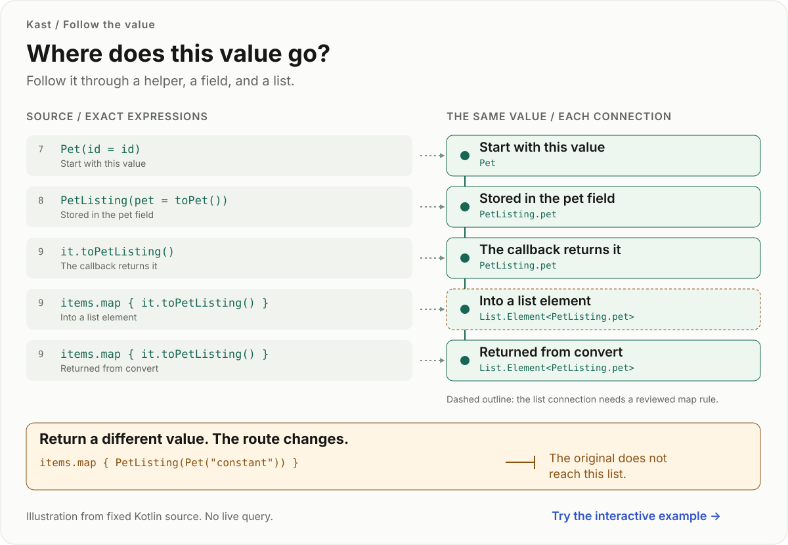

# Kast

**Your agent reads the code. Kast connects the pieces.**

Kast helps your coding agent understand how your Kotlin project fits together.
Trace a value through calls, fields, and callbacks. Find callers and
implementations, inspect diagnostics, and make targeted source changes—with
source locations and clear limits on what each answer establishes.

## Can my agent already do that?

Ask where a customer goes after a helper creates it from a sign-up.
A welcome-email draft holds that customer as its recipient. The draft can then
be part of a returned list, even though the last function never says `Customer`.

Change one expression, and the same list type can hold a draft for a different
customer. Names and types alone do not explain that difference.

[](https://kast.michne.com/explanation/value-journey/)

This image is an authored source illustration, not a live Kast result or a
record of execution. Kast gives your agent source locations and evidence for
these connections, including where the evidence stops.

[**Try the interactive example →**](https://kast.michne.com/explanation/value-journey/)

## Use it on your code

> Use Kast to trace this function's result. Show where it goes and where the evidence stops.

> Use Kast to find the callers of this function before we change it.

> Use Kast to inspect the diagnostics in this directory.

Kast builds on IntelliJ IDEA's Kotlin analysis. It connects that analysis into
project queries, value traces, and checked source changes for Codex, Copilot,
or Pi.

## Get started

You need an Apple silicon Mac, a Kotlin Gradle project, and IntelliJ IDEA
`262.*` with its bundled Kotlin plugin and Java 25 JBR.
Agent integrations need uv 0.12.9 or later and Python 3.12 or 3.13.
Codex setup also needs `codex` on `PATH`.

```shell
/bin/bash -c "$(curl -fsSL https://raw.githubusercontent.com/amichne/kast/main/install.sh)"
```

Accept the default Codex connection. Restart IDEA and Codex.
Select your Kotlin repository or worktree, then ask:

> Use Kast to find a Kotlin function in this workspace. Show its signature and source location.

[Installation guide](https://kast.michne.com/start/) ·
[Copilot and Pi](https://kast.michne.com/agent-harnesses/) ·
[Troubleshooting](https://kast.michne.com/troubleshooting/)

## Explore

- [Questions to ask your agent](https://kast.michne.com/search/).
- [Try a small exercise](https://kast.michne.com/tutorials/first-query/).
- [Technical reference](https://kast.michne.com/reference/).
- [Contribute to Kast](docs/development.md).

Kast describes connections in source. Your project's build and tests establish behavior after a change.

Kast uses the [GNU General Public License v3.0 only](LICENSE).
Report security issues through [private vulnerability reporting](https://github.com/amichne/kast/security/advisories/new).
