# Kast

**Give your coding agent the Kotlin knowledge your IDE already uses.**

Kast connects your agent to IntelliJ IDEA so it can find exact declarations,
trace their connections, inspect diagnostics, and make targeted source changes.

[](docs/demo/kast-demo.mp4)

Watch a 54-second edited evidence replay of Kast `v0.50.2` results from a small
public Kotlin fixture. Follow a response into `FeatureResponse.link`, then inspect an outgoing
request that remains unproven at the transport boundary. Recorded per-call waits
are preserved; reading pauses are added. Results are static compiler evidence.

[MP4](docs/demo/kast-demo.mp4) · [Still preview](docs/demo/kast-demo.png) ·
[Transcript and reproduction](docs/demo/README.md)

When several functions share a name, your agent needs to know which one matters.
When you change a function, it needs to know who calls it.
Kast gives it compiler-backed answers from your Kotlin project.

## From a question to the code that matters

Ask your agent:

> Find the callers of this function and show their source locations.

> Which classes implement this interface?

> Show the diagnostics in this directory before we change it.

Your agent gets declarations, relationships, and source locations that it can use
in its next step. Kast keeps each answer tied to the selected repository or
worktree and reports the limits of its evidence.

Use it to investigate unfamiliar code, trace the impact of a change, or give your
agent precise context for its next edit. Codex, Copilot, and Pi can all use Kast.

## Get started

You need an Apple silicon Mac, a Kotlin Gradle project, and IntelliJ IDEA
`262.*` with its bundled Kotlin plugin and Java 25 JBR.

Run this command:

```shell
/bin/bash -c "$(curl -fsSL https://raw.githubusercontent.com/amichne/kast/main/install.sh)"
```

The installer adds Kast and its IDEA plugin. Accept the default Codex connection.
Restart IDEA and Codex. Select your Kotlin repository or worktree. Ask:

> Use Kast to find a Kotlin declaration in this workspace. Show its signature
> and source location.

The plugin's MCP session starts preparation for `settings.gradle.kts` projects.
Semantic calls wait for the project and report setup blockers.
Codex owns its App Server and control socket. Pi uses native MCP without uv setup.

[Use Copilot or Pi](https://kast.michne.com/agent-harnesses/) ·
[Installation options](https://kast.michne.com/reference/installation/) ·
[Troubleshoot setup](https://kast.michne.com/troubleshooting/)

## Go further

- [Try a guided query](https://kast.michne.com/tutorials/first-query/) with a known result.
- [Find questions for your next task](https://kast.michne.com/search/).
- [Read what an answer proves](https://kast.michne.com/reference/evidence-boundaries/).
- [Upgrade or recover Kast](https://kast.michne.com/reference/management/).
- [Contribute to Kast](docs/development.md).

Kast is under the [MIT License](LICENSE).
Report security issues through [private vulnerability reporting](https://github.com/amichne/kast/security/advisories/new).
