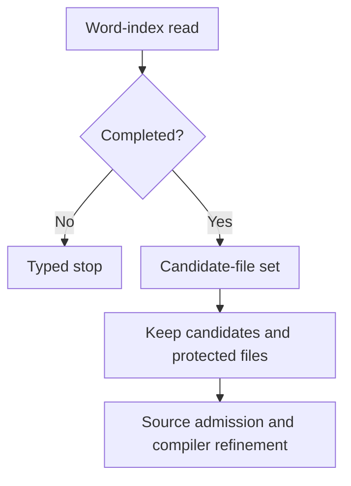
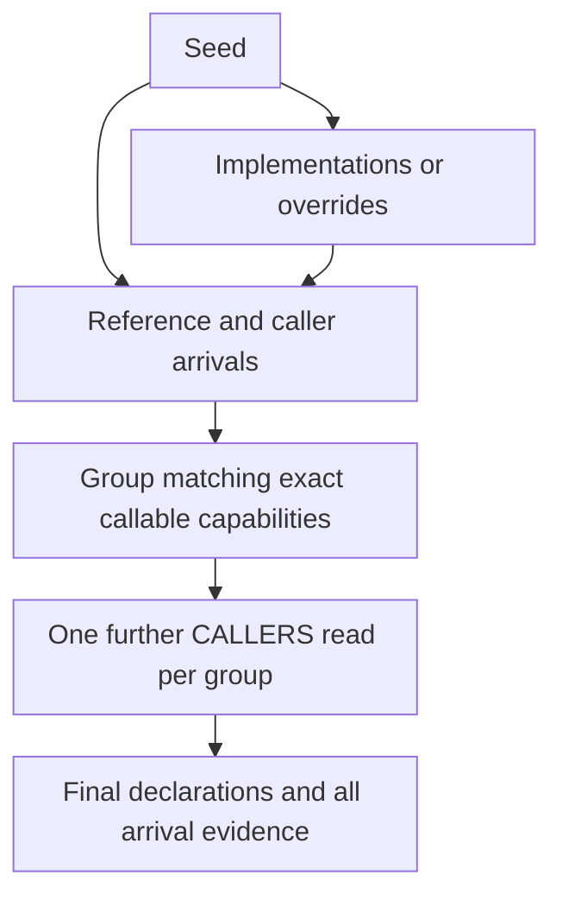

Kast reduces repeated work at the owner that can prove reuse legal. Each mechanism keeps the original scope, identity, and evidence.

The mechanisms answer different questions. A prepared file inventory does not prove a relationship, and a reused relationship read cannot erase an independent path.

| Mechanism | Reused or avoided work | Proof that stays necessary |
| --- | --- | --- |
| Exact-name file exclusion | Declaration work in ordinary noncandidate files | A complete index read, then compiler refinement of candidates. |
| TRACE grouping | Repeated downstream caller reads | Matching exact capabilities and all incoming occurrence evidence. |
| Reference inventory | Repeated native search preparation within one invocation | Current authority, subject, scope, purpose, and relation confirmation. |
| IMPACT read reuse | Repeated one-hop reads at an exact value site | Every route's producer, ordered history, and final obligations. |

## Reject irrelevant files before expensive work

An exact declaration name can permit a native word-index search. Only a completed read creates immutable evidence for candidate-file exclusion.

Kast then walks the bounded VFS inventory. It skips expensive source work for ordinary files outside that candidate set.

The set proves where exclusion is safe. It does not prove that a candidate contains the requested declaration.

<Accordion title="Exceptions and rejection rules">
  Invalid files and files too large for code intelligence keep the original admission path. They cannot silently disappear from coverage.

  Names without a sound indexed-word route use exhaustive discovery. Examples include spaced backtick names and implicit `Companion` discovery.

  A stopped or failed index read creates no exclusion object. Its collected prefix cannot stand in for a complete candidate set.

  File, work, and retained-byte limits still apply. The index does not grant unlimited discovery.
</Accordion>

## TRACE shares expansion and keeps arrivals

`TRACE` has a fixed topology. It visits the seed, implementations or overrides, uses, and one further caller layer.

For a type seed, direct callable members also enter as seeds. This membership does not create a call from the type to its member.

Several routes can reach the same callable. Kast groups matching callable arrivals before one downstream `CALLERS` read.

The group keeps independent reference, caller, and implementation-use evidence. It shares expansion because the exact capability matches, while each arrival keeps its evidence.

This path stops after its fixed caller layer. Use `WALK` for a different traversal extent.

## One prepared inventory can serve distinct relations

`REFERENCES` and `CALLERS` can need the same native reference inventory. Their semantic questions still differ.

The invocation owns one recent inventory slot. Its key includes current authority, subject, scope, and evidence purpose.

<AccordionGroup>
  <Accordion title="What enters the slot">
    Only an eligible provider inventory at cursor zero can enter. Its detached locators must fit the retained-byte allowance.

    The slot can hold the next eligible inventory instead. It is neither a project-wide result cache nor a continuation store.
  </Accordion>
  <Accordion title="What a matching read still does">
    The receiving collector admits the retained inventory against its capacity. The relation still proves its own meaning from the locators.

    A different key produces a miss. A matching inventory without enough receiving capacity reports unavailable.
  </Accordion>
</AccordionGroup>

## IMPACT shares reads and keeps every route

Two routes can reach the same exact value site. Kast can reuse a settled one-hop read at that site, including its finite rejection evidence.

Each route still keeps its own producer and ordered history. The interpreter expands the reused transfers separately for those routes.

If part of a read remains unfinished, Kast continues that read under the existing grant. A saved prefix alone does not establish a settled read.

The original ledger keeps branches, terminals, models, and unresolved obligations. Completion needs that whole ledger, even when a preview shows one path.

<Info>
  Fewer native reads do not mean fewer semantic paths. A merge of reads cannot replace proof for each route.
</Info>

For reuse across source states, continue with [retention and invalidation](/reference/staleness#incremental-facts-need-new-authority).

## Source evidence

<Accordion title="Owners and focused tests at 23828e1536">
  - [Exact-name exclusion](https://github.com/amichne/kast/blob/23828e1536835b5cae785b30254ac68059705926/symbol/intellij/src/main/kotlin/io/github/amichne/kast/symbol/intellij/IntellijExactNameCandidateFiles.kt) owns the completed candidate set. [Its tests](https://github.com/amichne/kast/blob/23828e1536835b5cae785b30254ac68059705926/symbol/intellij/src/test/kotlin/io/github/amichne/kast/symbol/intellij/ExactNameCandidateFilesTest.kt) cover failed reads and exhausted capacity.
  - [TRACE tasks](https://github.com/amichne/kast/blob/23828e1536835b5cae785b30254ac68059705926/query/service/src/main/kotlin/io/github/amichne/kast/query/service/QueryTraceTasks.kt) own the fixed phases and grouped arrivals.
  - [Reference inventory reuse](https://github.com/amichne/kast/blob/23828e1536835b5cae785b30254ac68059705926/relation/intellij/src/main/kotlin/io/github/amichne/kast/relation/intellij/IntellijReferenceInventoryReuse.kt) owns the slot and its key. [Its tests](https://github.com/amichne/kast/blob/23828e1536835b5cae785b30254ac68059705926/relation/intellij/src/test/kotlin/io/github/amichne/kast/relation/intellij/ReferenceInventoryReuseTest.kt) cover reuse and rejection.
  - [IMPACT tasks](https://github.com/amichne/kast/blob/23828e1536835b5cae785b30254ac68059705926/query/service/src/main/kotlin/io/github/amichne/kast/query/service/QueryImpactTasks.kt) own read reuse, remainders, and route expansion.
</Accordion>
