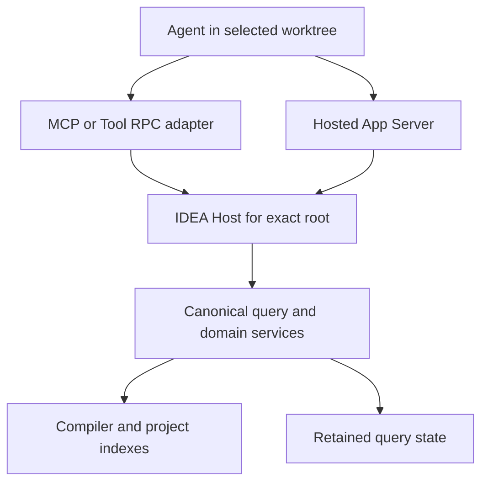

Kast separates the agent connection from the IDEA project that supplies semantic authority. One installed connection does not prove project readiness.

## Follow one request

1. The adapter carries the request from the selected repository or worktree.
2. The IDEA Host admits that exact root and its current read state.
3. The canonical query uses domain services backed by compiler analysis and project indexes.
4. Retained query state keeps produced evidence for later presentation. It cannot replace current compiler authority.

The arrows show responsibility, not a complete process or deployment graph. Direct adapters and hosted App Server have different session lifecycles.

## Find the source owner

| Boundary | Owner | Responsibility |
| --- | --- | --- |
| Agent adapters | `cli`, `app-server`, `copilot`, `pi` | Carry requests and preserve operation results. |
| IDEA integration | `runtime/hosted`, `workspace/intellij-read` | Admit the selected project and native read state. |
| Semantic coordination | `query/protocol`, `query/service` | Execute a fixed question and preserve completion evidence. |
| Domain facts | `symbol`, `relation`, `source`, `traversal`, `diagnostic` | Establish the supported program facts. |
| Stored evidence | `evidence`, `QueryStateStore` | Preserve identities, rows, and validity requirements. |
| Source changes | `change` | Plan, admit, apply, verify, and recover supported changes. |

A module name does not imply a separate process. Persistent change records and retained query state have different owners and lifetimes.

Use [Lifecycles](/reference/lifecycles) for connection and daemon ownership. Use [Staleness](/reference/staleness) for reuse requirements.

## Source evidence

Reviewed at `3ffe57068`. [settings.gradle.kts](https://github.com/amichne/kast/blob/3ffe570686a886cda71e8a0d6194b62592cbb90f/settings.gradle.kts) owns module inclusion.

[HostedCanonicalQuery](https://github.com/amichne/kast/blob/3ffe570686a886cda71e8a0d6194b62592cbb90f/runtime/hosted/src/main/kotlin/io/github/amichne/kast/runtime/hosted/HostedCanonicalQuery.kt) composes the admitted project, domain services, and retained state.

[The source map](/reference/source-map) links adapter dispatch and focused tests.
