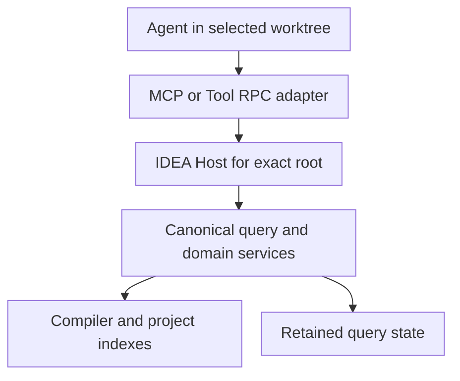

The agent connection carries requests. The IDEA project supplies semantic authority. An installed connection alone does not prove that the project is ready.

## Follow one request

1. The adapter carries the request from the selected repository or worktree.
2. The IDEA Host admits that exact root and its current read state.
3. The canonical query uses domain services. The compiler and project indexes back those services.
4. Retained query state keeps the evidence for later reads. It cannot replace current compiler authority.

The arrows show who owns each part. They do not show every process or how it is deployed. MCP and Tool RPC have distinct session lifecycles. The current Codex plugin uses MCP. Codex owns its App Server and control socket.

## Find the source owner

| Layer | Owner | Responsibility |
| --- | --- | --- |
| Agent adapters | `cli`, `copilot`, `pi` | Carry requests and keep operation results. |
| IDEA integration | `runtime/hosted`, `workspace/intellij-read` | Admit the selected project and native read state. |
| Semantic coordination | `query/protocol`, `query/service` | Execute a fixed question and keep completion evidence. |
| Domain facts | `symbol`, `relation`, `source`, `traversal`, `diagnostic` | Prove the supported program facts. |
| Stored evidence | `evidence`, `QueryStateStore` | Keep identities, rows, and validity requirements. |
| Source changes | `change` | Plan, admit, apply, verify, and recover supported changes. |

A module need not run in its own process. Stored change records and retained query state have distinct owners and lifetimes.

Use [Lifecycles](/reference/lifecycles) for connection and daemon ownership. Use [Staleness](/reference/staleness) for reuse requirements.

## State owners and lifetimes

State lives at the smallest owner that can enforce its validity. Several forms of state can coexist during one request.

| State | Owner | Validity limit |
| --- | --- | --- |
| Preparation status | `WorkspacePreparations` | One operation for the exact canonical root, with bounded lookup history. |
| Completed file and tree hashes | `SemanticNativeFileMemo` | One native capture try. Incomplete hashes never enter the memo. |
| Prepared reference locators | `IntellijReferenceInventoryReuse` | One invocation, with matching authority, subject, scope, and purpose. |
| Pending tasks and immutable output | `QueryStateStore` | Project ownership, admitted authority, capacity, and lifetime. |
| Completed callback and relation facts | `SemanticCallbackFactStore` | Project ownership and a dependency comparison before reuse. |
| Change plans and receipts | Change and evidence services | The exact plan, target, preimage, and recovery phase. |

Preparation state cannot answer a semantic question. A query checkpoint cannot authorize a change. A stored fact cannot renew an old output handle.

<Columns cols={2}>
  <Card title="Reuse within a query" icon="repeat" href="/architecture/query-reuse">
    Examine which repeated reads can share work without losing evidence.
  </Card>
  <Card title="Reuse across source states" icon="history" href="/reference/staleness#incremental-facts-need-new-authority">
    See why unchanged dependencies still need current endpoint admission.
  </Card>
</Columns>

## Source evidence

Reviewed at `a6faea2de`. [`settings.gradle.kts`](https://github.com/amichne/kast/blob/a6faea2de1e9f1043b121cdd7fef691a4320a37a/settings.gradle.kts) owns module inclusion.

[`HostedCanonicalQuery`](https://github.com/amichne/kast/blob/a6faea2de1e9f1043b121cdd7fef691a4320a37a/runtime/hosted/src/main/kotlin/io/github/amichne/kast/runtime/hosted/HostedCanonicalQuery.kt) joins the admitted project, domain services, and retained state.

[`KastMcpMain`](https://github.com/amichne/kast/blob/a6faea2de1e9f1043b121cdd7fef691a4320a37a/cli/src/main/kotlin/io/github/amichne/kast/cli/mcp/KastMcpMain.kt) binds the client-owned MCP session and its setup callback. This transport starts no App Server or broker.

[The source map](/reference/source-map) links adapter dispatch and focused tests.

<Accordion title="State owners examined at 23828e1536">
  [`SemanticNativeFileMemo`](https://github.com/amichne/kast/blob/23828e1536835b5cae785b30254ac68059705926/topology/intellij/src/main/kotlin/io/github/amichne/kast/topology/intellij/SemanticNativeFileMemo.kt) keeps only complete hashes during one capture.

  [`QueryStateStore`](https://github.com/amichne/kast/blob/23828e1536835b5cae785b30254ac68059705926/query/protocol/src/main/kotlin/io/github/amichne/kast/query/protocol/QueryStateStore.kt) owns shared retention limits and publication.

  [Query reuse](/architecture/query-reuse#source-evidence) and [staleness](/reference/staleness#source-evidence) link the inventory and incremental-fact owners.
</Accordion>
