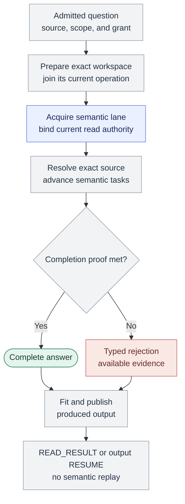
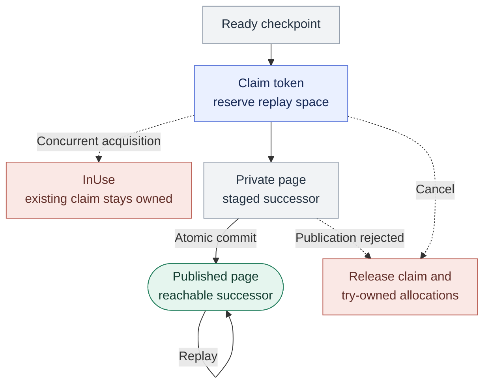

A public `RUN` answers one fixed source question. Its output can span several replies without more semantic work.

Execution and delivery have distinct limits because a complete answer can exceed one response's byte allowance.

Preparation proves readiness for the exact root. Each semantic read still needs current authority. [Topology](/architecture/topology) locates these owners.

The diagram shows the path after workspace and lane admission succeed. Preparation or admission can reject before semantic tasks start.

The interpreter keeps each operation's meaning. Direct relations read one named relationship. `TRACE` uses fixed phases, `WALK` tracks a frontier, and `IMPACT` keeps value routes.

Output actions need an issued retained-result reference or output continuation. A reply without that handle does not permit the corresponding read.

## One question and one execution grant

A public `RUN` selects its source, ordered steps, output, and scope. Kast admits one grant. It covers work, elapsed time, and retention.

The runner drains internal semantic pages under that grant. An empty page can still advance a search or relationship read.

Every public run uses `COMPLETE_ONLY` within `COMPILER_RESOLVED_STATIC_V1`. To complete, the run must finish its work and meet all proof rules.

Item failures, omitted evidence, and unmet proof rules prevent completion. Each investigation uses its declared interpretation of callback evidence.

For source-symbol `TRACE`, `SOURCE_RELATIONSHIPS` keeps callback execution gaps as evidence. Invocation queries need the stricter callback graph proof.

[RUN completion](/reference/responses#run-completion) defines which composed queries need that stricter proof.

## A preview describes delivery

A complete investigation can produce more evidence than fits in one reply. The preview shows the rows that fit the output limit.

The row count does not count semantic work left to do. A small result also does not prove that the run had enough work or storage capacity.

<Info>
  A rejected or incomplete query does not prove that a caller is absent.
</Info>

## Publish a page and its successor together

`QueryStateStore` owns detached checkpoints, retained results, output suffixes, and publication claims under shared entry, byte, and lifetime limits.

Before a producer advances, acquisition reserves replay space and claims its token. A concurrent acquisition of that unfinished token reports `InUse`.

The page and its reachable successor become visible in one store transition. A later read of a published page replays its immutable output.

Cancellation or rejected publication releases only allocations owned by that try. It does not revoke an existing public page that the try reused.

This diagram shows internal publication. It does not expose producer checkpoints as public semantic `RESUME` inputs.

## Retention keeps the original answer

A retained result keeps rows that cannot change. It also keeps their identity, stated limits, and original producer progress. Its reference names that stored result.

| Action | Reads | Position |
| --- | --- | --- |
| `READ_RESULT` | Immutable retained rows and evidence | Independent row and evidence cursors. |
| `RESUME` | Already-produced output | An issued output continuation. |

Neither action grants a stronger answer. A rejection can include a historical execution checkpoint. That checkpoint does not authorize another strict run.

## State determines whether reuse remains legal

Retained evidence belongs to its workspace, IDEA owner, read epoch, committed source state, and lifetime.

Kast can revalidate an exact declaration through the compiler. Retained results and output continuations need their original state.

If that state is not available, start a new query. It produces a new answer. It cannot restore the old delivery.

[Read retained evidence](/how-to/read-retained-evidence) gives the procedure. [Results](/reference/responses) defines the encoded fields and rejection causes.

## Source evidence

<Accordion title="Dispatch, publication, and proof at 722ae03fc1">
  - [`CanonicalQueryProtocol`](https://github.com/amichne/kast/blob/722ae03fc19193f233d380ee95c221c527178767/query/protocol/src/main/kotlin/io/github/amichne/kast/query/protocol/CanonicalQueryProtocol.kt) owns public action dispatch.
  - [`QueryStateStore`](https://github.com/amichne/kast/blob/722ae03fc19193f233d380ee95c221c527178767/query/protocol/src/main/kotlin/io/github/amichne/kast/query/protocol/QueryStateStore.kt) owns publication and release.
  - [`QueryStateAcquisition`](https://github.com/amichne/kast/blob/722ae03fc19193f233d380ee95c221c527178767/query/protocol/src/main/kotlin/io/github/amichne/kast/query/protocol/QueryStateAcquisition.kt) owns token acquisition and replay capacity.
  - [`QueryCheckpointPublicationTest`](https://github.com/amichne/kast/blob/722ae03fc19193f233d380ee95c221c527178767/query/protocol/src/test/kotlin/io/github/amichne/kast/query/protocol/QueryCheckpointPublicationTest.kt) covers replay, concurrent acquisition, cancellation, and private result visibility.

  [OpenWiki's semantic-query concept](https://github.com/amichne/kast/blob/main/openwiki/flows/semantic-query.md) connects these owners to the interpreter.
</Accordion>
