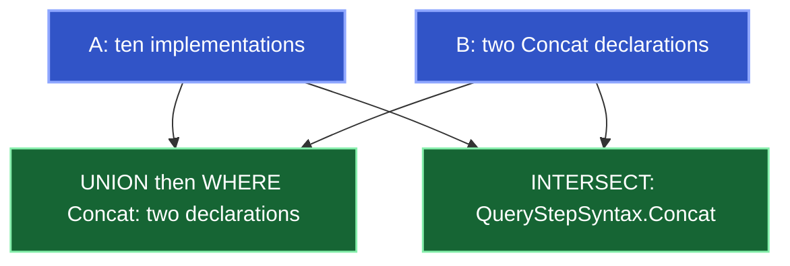

Use `retention: "RETAIN"` to save query results for composition. Set operations compare rows by exact symbol identity. Pass each issued result reference unchanged.

<a id="require-a-complete-static-answer" />

## Complete static answers

Every `RUN` needs a complete answer within `COMPILER_RESOLVED_STATIC_V1`. The original question records this fixed model. Requests cannot select another completion policy.

Automatic execution drains symbol, occurrence, traversal, and binding rows under one execution budget. A bounded preview can reference saved rows without a change to upstream completion.

The model covers compiler-resolved source relationships in the admitted domain. Runtime activation needs separate evidence. Walk completion applies to the requested maximum depth.

Compiler evidence can establish finite graphs for exact direct and forwarded callback argument routes. Stored, returned, default, recursive, unresolved, and unproven owner routes remain typed rejections. Other value-call interfaces need a supported graph model.

Unsupported outputs return `COMPLETION_UNSUPPORTED`. Incomplete execution or an unproven callback graph returns `COMPLETION_UNPROVEN`. That rejection keeps the original coverage and an evidence reference when storage admits it. A storage failure appears explicitly in the rejection.

To inspect the proven prefix, use `READ_RESULT` with the evidence reference. Reads of rejected answers carry `POLICY_REJECTED_EVIDENCE`. Enumeration coverage does not reverse the model rejection. Original producer progress remains historical. Recovery uses `EVIDENCE_ONLY` and grants presentation of evidence.

These examples use a [historical recording](/reference/schemas#recorded-walkthrough) against [Kast at `56df091`](https://github.com/amichne/kast/tree/56df0912e46b182bb4ad8beabd1512823100fd72). Counts describe that run. **A**, **B**, and **C** label its inputs and results. For your session, use fresh references.

<a id="retain-a-second-query-result" />

## Save a second query result

The [walkthrough](/reference/walkthrough) saves **A**, ten implementations of `QueryStepSyntax`. The next query saves **B**, two class-like declarations named `Concat` under `query/contract` in `main`.

Only `QueryStepSyntax.Concat` implements the interface. `ExactQueryStage.Concat` shares its name but has a different declaration identity.

<Accordion title="Request: discover and retain input B">
  ```json
  {
    "request": {
      "type": "RUN",
      "executionBudget": {"maxElapsedMs": 15000},
      "source": {
        "type": "SEARCH_DECLARATIONS",
        "declarationName": "Concat",
        "declarationKinds": ["CLASS"],
        "scope": {
          "type": "DIRECTORY",
          "relativeDirectoryPath": "query/contract",
          "sourceSetNames": ["main"]
        }
      },
      "output": {"type": "SYMBOLS", "fields": ["NAME", "LOCATION", "SIGNATURE"]},
      "retention": "RETAIN"
    }
  }
  ```
</Accordion>

## Combine both inputs, then filter the combined stream

`UNION` combines rows by identity. A later `WHERE` applies to the combined stream.



Recorded call `04-union-filter` returned both declarations with exhaustive coverage. The name filter applied after the union.

<Accordion title="Request: union by identity, then filter by name">
  ```json
  {
    "request": {
      "type": "RUN",
      "executionBudget": {"maxElapsedMs": 15000},
      "source": {"type": "RESULT", "result": "<result A>"},
      "steps": [
        {"type": "UNION", "right": {"type": "RESULT", "result": "<result B>"}},
        {
          "type": "WHERE",
          "predicate": {
            "type": "PRIMITIVE",
            "field": "NAME",
            "operator": "EQUALS",
            "value": "Concat"
          }
        }
      ],
      "output": {"type": "SYMBOLS", "fields": ["NAME", "LOCATION", "SIGNATURE"]}
    }
  }
  ```

  `CONCAT` with `input` preserves order and duplicate rows. To include more saved inputs, add union steps before the filter.
</Accordion>

## Keep only symbols present in both

Recorded call `05-intersection` returned only `QueryStepSyntax.Concat`, the shared declaration. Incomplete inputs keep their qualifications through intersection.

<Accordion title="Request: intersect retained inputs">
  ```json
  {
    "request": {
      "type": "RUN",
      "executionBudget": {"maxElapsedMs": 15000},
      "source": {"type": "RESULT", "result": "<result A>"},
      "steps": [
        {"type": "INTERSECT", "right": {"type": "RESULT", "result": "<result B>"}}
      ]
    }
  }
  ```
</Accordion>

## Keep the matched pair, then select a side and continue

An `INNER` join preserves evidence from both rows. Name its cells. Before another relationship step, select one cell with `PROJECT_BINDING`.

Recorded call `06-join-c` saved one pair as **C**. Both cells identified `QueryStepSyntax.Concat`. The `step` cell kept implementation evidence, and `candidate` kept discovery evidence. Different reference strings can identify the same declaration.

<Accordion title="Requests: save pairs as C, then trace one side">
  ```json
  {
    "request": {
      "type": "RUN",
      "executionBudget": {"maxElapsedMs": 15000},
      "source": {"type": "RESULT", "result": "<result A>"},
      "steps": [
        {
          "type": "JOIN",
          "mode": {"type": "INNER", "leftName": "step", "rightName": "candidate"},
          "right": {"type": "RESULT", "result": "<result B>"}
        }
      ],
      "output": {"type": "BINDING_ROWS"},
      "retention": "RETAIN"
    }
  }
  ```

  To trace the `step` cell's references, use:

  ```json
  {
    "request": {
      "type": "RUN",
      "executionBudget": {"maxElapsedMs": 15000},
      "source": {"type": "RESULT", "result": "<result C>"},
      "steps": [
        {"type": "PROJECT_BINDING", "name": "step"},
        {"type": "EXPAND_RELATION", "relation": "REFERENCES"}
      ],
      "output": {"type": "OCCURRENCES"}
    }
  }
  ```

  Recorded call `07-project-references` found this compiler-confirmed use:

  ```kotlin
  is QueryStepSyntax.Concat -> ExactQueryStage.Concat(step.input, stage)
  ```
</Accordion>

Queries do not support arbitrary-field joins or a general-purpose `MAP`.

## Choose the relationship search domain

`EXPAND_RELATION` defaults to `WORKSPACE`. Without `maximumDepth`, or with a null depth, `WALK` exhausts the reachable graph and defaults to `WORKSPACE`. With an explicit depth, it defaults to `RETAINED_SEED`.

An explicit `expansionScope` overrides either default. It controls the search domain before enumeration. A later `WHERE` filters returned rows without a reduction in native search work.

To restrict the source domain explicitly, use:

```json
{
  "type": "EXPAND_RELATION",
  "relation": "REFERENCES",
  "expansionScope": {
    "type": "SOURCE_DOMAIN",
    "sourceSets": ["main"],
    "directory": "query/contract",
    "includeSubdirectories": true,
    "sourcePolicy": "PRODUCTION_ONLY",
    "generatedSources": "EXCLUDE"
  }
}
```

Coverage applies to the specified domain. This current example does not change the historical counts.

## Read produced output or retained rows

Use `RESUME` to present the remaining produced output. Use `READ_RESULT` to present stored rows without semantic work. A result cursor selects the next stored page. Output presentation and composition keep the original limitations.

<Accordion title="Requests: resume output or read retained rows">
  ```json
  {"request":{"type":"RESUME","continuation":"<issued output continuation>"}}
  ```

  ```json
  {"request":{"type":"READ_RESULT","result":"<issued symbol-result reference>"}}
  ```

  ```json
  {"request":{"type":"READ_RESULT","result":"<result C>","output":{"type":"BINDING_ROWS"}}}
  ```

  Recorded calls `08-read-a` and `09-read-c` returned ten symbols and one pair. Both results kept their original identities.
</Accordion>

The internal runner owns semantic page continuations. A completion rejection can keep proof for inspection. Its historical checkpoint does not authorize execution.

<a id="reject-an-incomplete-absence-check" />

### Reject an unproven absence claim

`DIFFERENCE` and `ANTI` need complete coverage of the `right` input to establish absence. Recorded call `10-incomplete-right` supplied an incomplete input. Both operations rejected it:

```json
{
  "status": "rejected",
  "rejection": {
    "type": "execution-rejected",
    "reason": "right-input-incomplete"
  },
  "next_action": "correct_request"
}
```

That historical search ended with `upstream-incomplete` progress. Current exact-name search can keep candidates beyond output limits. `ALL_DECLARATIONS` can keep its discovery position. Native work or byte limits can still leave coverage incomplete.

Edits, builds, and IDEA state changes can invalidate saved results. Before reuse, read the recovery and handle rules in [Results](/reference/responses).
