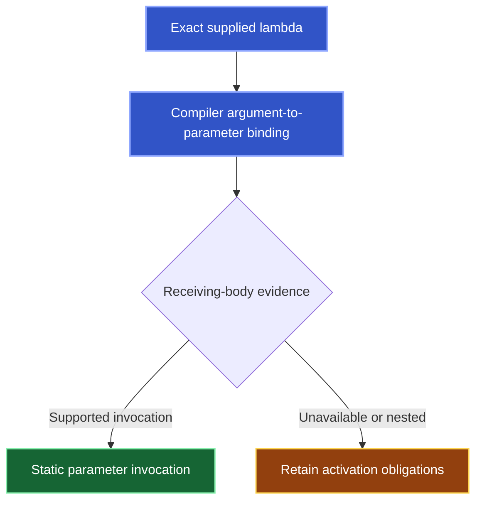

Kast identifies anonymous callables separately from their enclosing named functions. The ownership evidence qualifies callers and callees separately from lexical containment. Static callback paths do not prove runtime execution.

## Named callers and lexical ownership

`REFERENCES` records lexical containment. `CALLERS` and `CALLEES` include `callback_observations`. Each observation keeps the exact occurrence, lexical owner, anonymous body, and named-call policy.

[The named-edge policy reference](/reference/callback-observations#named-edge-policy) defines the closed variants.


## Static bindings and unfinished proof

Compiler argument mapping connects a supplied callback to a formal parameter. The receiving body's evidence establishes supported static invocations or records unresolved activation obligations.



`binding.type` identifies how the callable receives its value:

[The binding forms reference](/reference/callback-observations#binding-forms) defines the closed variants.


Direct admission needs the compiler's builtin function invocation. Labels and parentheses preserve the compiler's argument mapping. A default records its defining formal and default expression. A supplied argument replaces the default, so the default does not create caller edges for every call.

Each parameter invocation keeps `forwardings` for every hop. These records identify the source formal, exact supplied expression, and destination argument binding. Immutable local aliases keep their existing value-transfer proof. Forwarding through an alias, mutable storage, returns, and cycles can leave unresolved obligations.

`scan` reports the extent of static formal-invocation enumeration:

[The invocation scan reference](/reference/callback-observations#invocation-scan) defines the closed variants.


An exhaustive scan can still carry `NESTED_CALLBACK_EXECUTION`. Enumeration identifies sites without proof that a nested callable owner executes. That limit includes local named functions.

`owner_bindings` keeps an anonymous owner's supply and mapping when available. Read the obligations to identify unresolved proof:

[The unresolved obligations reference](/reference/callback-observations#unresolved-obligations) defines the closed variants.


Unresolved mappings, external callback bodies, escaped parameters, and exhausted resource allowances keep their qualifications. The resource limits cover work, time, results, and bytes. Inline policy excludes `noinline` and `crossinline` bodies from named edges and records the reason.

<a id="symbolic-callees-and-known-boundaries" />

## Reviewed dependency models

A supported calls-in-place dependency contract keeps the compiler-mapped parameter and dependency class digest. It does not invent dependency body invocations.

For `kotlin.lazy`, `KOTLIN_LAZY_JVM_V1` admits reviewed digests for the facade, factory, three initializer implementations, and mode dispatch.

`DEFERRED_DEPENDENCY` records the named callable or property that supplies the initializer. It records no invocation site or invocation count.

The initializer remains a deferred body. Its lexical container does not gain a direct named caller edge merely because it supplies that body.

Unavailable or unreviewed binaries preserve a finite dependency-model rejection. The model does not establish access to the lazy value or initializer execution.

[Source map](/reference/source-map#callback-and-deferred-ownership) identifies the contract and wire rejection tests.

## Symbolic callees and source exclusions

`CALLEES` also includes `callable_observations`. For `block()` or `block.invoke()`, a `PARAMETER_INVOCATION` target records the named defining callable, formal position, parameter occurrence, and actual invocation owner. The target describes a symbolic callee. It does not select a runtime function value. Formals owned by anonymous functions remain unsupported.

A `SOURCE_LESS` target keeps the resolved compiler callable identity and compiler module even without source PSI. Builtins and libraries excluded by the requested policy permit complete enumeration as known exclusions.

If requested library sources are unavailable, the observation keeps `LIBRARY_SOURCE_UNAVAILABLE`. Coverage remains qualified. Missing PSI alone does not establish an external source exclusion.

<a id="read-the-exact-anonymous-source" />

## Anonymous source selectors

`READ_SOURCE` accepts the anonymous body's issued `candidateSelector` as `candidateRef`:

```json
{
  "request": {
    "type": "READ_SOURCE",
    "candidateRef": "<issued candidateSelector>"
  }
}
```

An epoch change needs a fresh selector. The anonymous body remains the target. Its enclosing named function is a separate identity.

<a id="continue-output-delivery" />

## Output delivery

`page_progress` counts page rows and evidence. A zero-row page can advance callback or callable output. Issued tokens and `next_action` describe available delivery. [Read retained evidence](/how-to/read-retained-evidence) gives the procedure. Traversal coverage can be complete before delivery finishes. See [Results](/reference/responses#follow-progress-not-row-count) for output progress.

Consumers must use the current advertised schema. Relation and walk schemas need `callable_observations`, including empty arrays. Observed callback flows need `scan`. Parameter invocation entries need `forwardings`, including empty arrays. Payloads without these fields reject admission.
