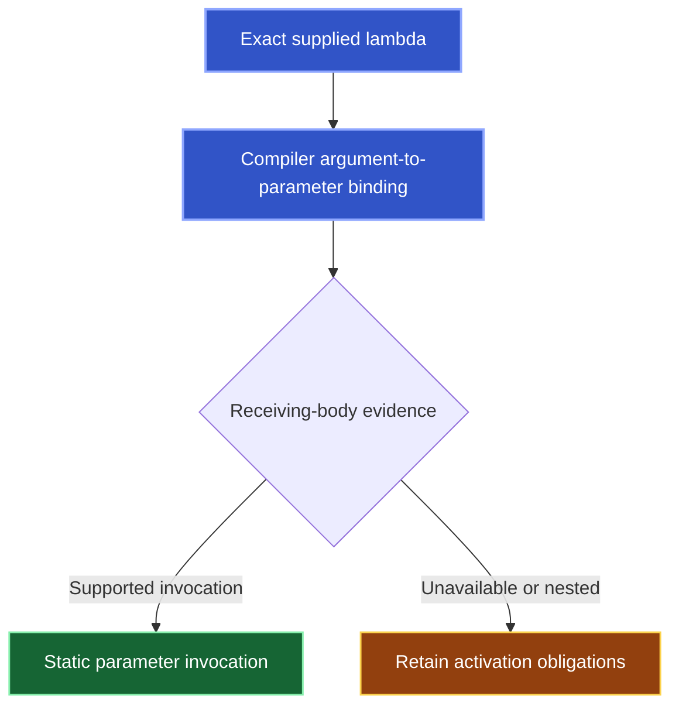

Kast identifies anonymous callables separately from their enclosing named functions. Use that ownership evidence to interpret callers and callees. Static callback paths do not prove runtime execution.

## Named callers and lexical ownership

`REFERENCES` records lexical containment. `CALLERS` and `CALLEES` include `callback_observations`. Each observation keeps the exact occurrence, lexical owner, anonymous body, and named-call policy.

| Policy | Named-edge meaning |
| --- | --- |
| `EXCLUDED` | Invocation is absent from named callers, with its reason. |
| `ADMITTED_DIRECT` | A compiler-confirmed immediate invocation admits a named edge while preserving its anonymous body. |
| `ADMITTED_INLINE` | Inline policy admits a named edge while preserving the anonymous owner. |
| `UNAVAILABLE` | Ownership remains incomplete. |

## Static bindings and unfinished proof

Compiler argument mapping connects a supplied callback to a formal parameter. The receiving body's evidence establishes supported static invocations or records unresolved activation obligations.



Read `binding.type` to identify how the callable receives its value:

| Binding | Meaning |
| --- | --- |
| `BOUND` | An explicit argument supplies the value. |
| `DEFAULT` | A declared default supplies the value. |
| `DIRECT` | A literal or anonymous function is invoked directly. |
| `UNAVAILABLE` | The mapping is unavailable. |

Direct admission needs the compiler's builtin function invocation. Labels and parentheses preserve the compiler's argument mapping. A default records its defining formal and default expression. A supplied argument replaces the default, so the default does not create caller edges for every call.

Each parameter invocation keeps `forwardings` for every hop. These records identify the source formal, exact supplied expression, and destination argument binding. Immutable local aliases keep their existing value-transfer proof. Forwarding through an alias, mutable storage, returns, and cycles can leave unresolved obligations.

Use `scan` to read the extent of static formal-invocation enumeration:

| Scan | Meaning |
| --- | --- |
| `EXHAUSTIVE` | The admitted scan finished. Empty invocations establish no supported invocation sites in that scanned flow. |
| `INCOMPLETE` | A limit or unsupported flow prevents an absence claim. |
| `NOT_APPLICABLE` | A directly invoked body has no receiving formal to scan. |

An exhaustive scan can still carry `NESTED_CALLBACK_EXECUTION`. Enumeration identifies sites without proof that a nested callable owner executes. That limit includes local named functions.

`owner_bindings` keeps an anonymous owner's supply and mapping when available. Read the obligations to identify unresolved proof:

| Evidence | Limit |
| --- | --- |
| Nested callable owner | `NESTED_CALLBACK_EXECUTION` |
| Library mapping | `EXTERNAL_CALLABLE` and `OUTSIDE_DOMAIN` |
| Local initializer | `STORED_CALLBACK` |
| Returned literal | `RETURNED_CALLBACK` |
| Unsupported supply | `UNSUPPORTED_CALLBACK_SUPPLY` |
| Recursive forwarding | `CALLBACK_CYCLE` |

Unresolved mappings, external callback bodies, escaped parameters, and exhausted resource allowances keep their qualifications. The resource limits cover work, time, results, and bytes. Inline policy excludes `noinline` and `crossinline` bodies from named edges and records the reason.

<a id="symbolic-callees-and-known-boundaries" />

## Symbolic callees and source exclusions

`CALLEES` also includes `callable_observations`. For `block()` or `block.invoke()`, a `PARAMETER_INVOCATION` target records the named defining callable, formal position, parameter occurrence, and actual invocation owner. The target describes a symbolic callee. It does not select a runtime function value. Formals owned by anonymous functions remain unsupported.

A `SOURCE_LESS` target keeps the resolved compiler callable identity and compiler module even without source PSI. Builtins and libraries excluded by the requested policy permit complete enumeration as known exclusions.

If requested library sources are unavailable, the observation keeps `LIBRARY_SOURCE_UNAVAILABLE`. Coverage remains qualified. Missing PSI alone does not establish an external source exclusion.

## Read the exact anonymous source

To read an anonymous body, pass its issued `candidateSelector` unchanged:

```json
{
  "request": {
    "type": "READ_SOURCE",
    "candidateRef": "<issued candidateSelector>"
  }
}
```

After an epoch change, get a fresh selector. Keep the anonymous body as the target. Do not substitute its enclosing named function.

## Continue output delivery

`page_progress` counts page rows and evidence. A zero-row page can advance callback or callable output. Use the issued tokens and `next_action` to continue delivery. Traversal coverage can be complete before delivery finishes. See [Results](/reference/responses#follow-progress-not-row-count) for output progress.

Consumers must use the current advertised schema. Relation and walk schemas need `callable_observations`, including empty arrays. Observed callback flows need `scan`. Parameter invocation entries need `forwardings`, including empty arrays. Payloads without these fields reject admission.
