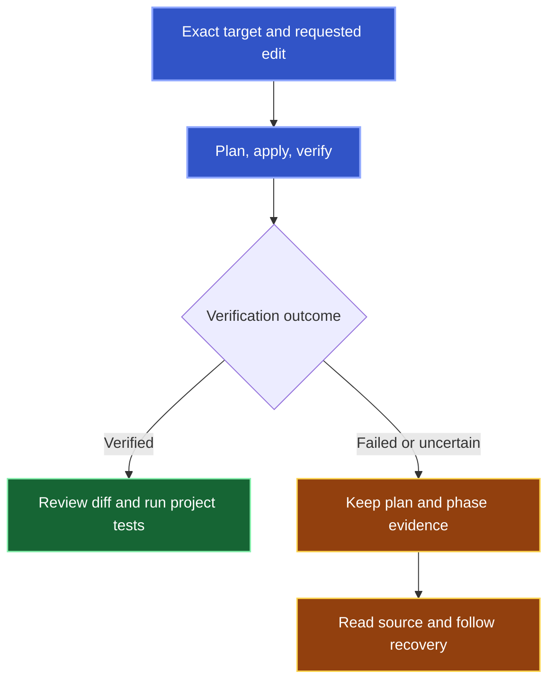

<a id="exact-inputs-for-tool-authors" />

Use this guide after you authorize one source change. Kast can add a declaration to an existing file or replace a supported block body. Before a change, [find the target and read its source](/reference/search). Pass the exact reference from that result unchanged.

<a id="check-the-target-and-scope" />

<a id="select-the-target-and-scope" />


1. [Select the exact target and supported change.](#1-select-the-target-and-scope)
2. [Establish the source effect from the receipt.](#2-establish-the-source-effect)
3. [Review the diff and run project tests.](#read-the-receipt)

## 1. Select the target and scope

To select the target, substitute your function and directory in this prompt:

```text wrap
Use Kast to find retryLimit under checkout. Show matching signatures and locations. If several functions match, stop so I can choose. Read the selected function's source and check whether it has a supported block body before changing it.
```

After you select the target, request the change:

```text wrap
Use Kast to replace the chosen function's body with { return 3 }. Keep its signature and the source outside the body unchanged. Report verification and the change receipt; if the outcome is uncertain, preserve recovery evidence and stop before retrying the write.
```

Body replacement accepts a non-inline named function with a block body and no contract. Change tools reject file creation, arbitrary range edits, symbol renames, and multi-file refactors.

<a id="read-the-receipt" />

## 2. Establish the source effect

One call plans, applies, and verifies the edit. Examine the receipt. Review the diff before you accept the result.



<Note>
  A rejection, timeout, or lost response leaves the write outcome uncertain until source and recovery evidence establish the effect.
</Note>

If the outcome is uncertain, examine the source and recovery evidence before another write.

IDEA diagnostics and edit verification cover the scope in the receipt. After a verified change, run your project's build and tests.

## 3. Use the supported input form

These examples use placeholders. Replace each placeholder with a current reference from Kast.

<AccordionGroup>
  <Accordion title="Add a declaration">
    ```json
    {
      "exactTarget": "<exact-ref-returned-by-Kast>",
      "declaration": "fun retryLimit(): Int = 3"
    }
    ```

    Select the existing file. Examine the insertion location before the change. Use the [Add declaration schema](/reference/callables/add-declaration) for exact inputs.
  </Accordion>

  <Accordion title="Replace a function body">
    ```json
    {
      "exactTarget": "<exact-function-ref-returned-by-Kast>",
      "body": "{ return 3 }"
    }
    ```

    Supply the complete block with its braces. Use the [Replace body schema](/reference/callables/replace-body) for exact inputs.
  </Accordion>

  <Accordion title="Carry exact identity across a change">
    Kast treats `exact:v5:…` and `exact:v3:…` as opaque handles. Keep each prefix and the rest of its handle unchanged.

    After verified replacement, pass the returned `freshRef` to a later `add_declaration`. Kast must still examine the authority of pre-write references.
  </Accordion>
</AccordionGroup>
