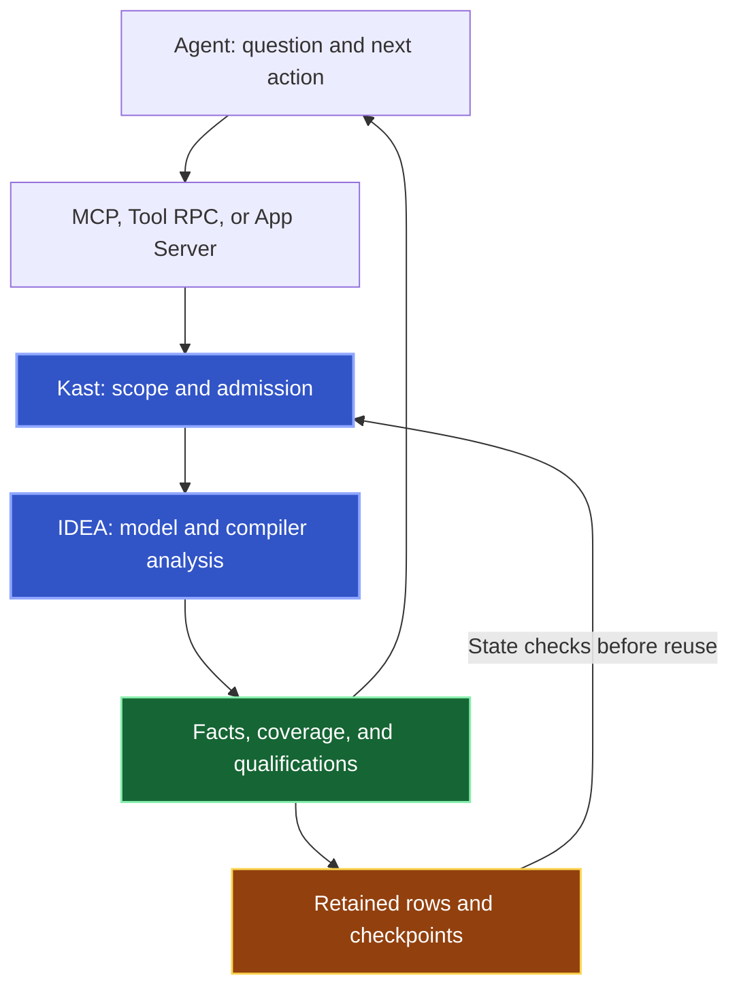

Kast answers your agent's questions through the IDEA project for the exact repository. The answer includes facts, their search scope, source state, and limitations.

## Authority stays with the program

IDEA supplies the imported Gradle model, Kotlin plugin, and indexes. Kast uses indexes to discover candidates and compiler analysis to establish their semantic identity.

MCP, Tool RPC, and App Server adapters preserve the operation document in their transport wrappers. Saved rows and checkpoints keep the evidence from that operation. Compiler authority still determines semantic identity.

## Bounded execution preserves progress

Queries use configured limits for work, bytes, results, and elapsed time. Public `RUN` drains semantic pages within one grant. `RESUME` presents produced output through an issued continuation. A terminal result reports why the operation stopped.

The internal runner keeps unvisited files and the active file position for `ALL_DECLARATIONS`. A filter can remove every row from a page while execution still advances. [Results](/reference/responses#follow-progress-not-row-count) explains semantic execution and output presentation.

## Read state constrains reuse

Before Kast restores saved work, it examines the workspace root, owning IDEA instance, read epoch, committed source state, and lifetime. Saved work contains references rather than live compiler objects.

An exact symbol can undergo fresh compiler revalidation. Saved results and continuations need their original read state. See [Saved state and identity](/reference/responses#saved-state-and-identity) for reuse rules.

Queries [prepare IDEA automatically](/reference/internals/background-startup). Trust, save, import, and indexing blockers produce explicit failures. A tool catalog establishes the available contract. It does not establish project readiness.
