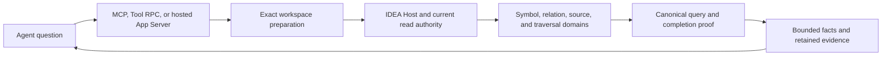

<a id="bounded-execution-preserves-progress" />

Kast obtains semantic facts from the IDEA project for one exact repository. Transport adapters carry those facts to the agent with their source state and proof limits.

## Authority stays with the program

IDEA supplies the imported Gradle model, bundled Kotlin compiler analysis, and indexes. Indexes find candidates, and compiler evidence establishes their meaning.

The owning domain admits exact declarations and relationships. The query protocol coordinates those reads and preserves their qualifications.

Control owns installed adapters and coordination. Host owns IDEA integration and project admission. Compatibility connects those components before a semantic operation.

## Execution and presentation have separate limits

`CanonicalQueryProtocol` owns public action dispatch and internal semantic continuation. It keeps one question and one execution grant throughout a run.

Discovery preserves unvisited files and active source positions. A filtered empty page can advance execution without a new result row.

`QueryStateStore` owns retained rows and output state. Presentation uses issued authority from that owner and preserves original coverage.

Public `RESUME` and `READ_RESULT` do no semantic replay. A retained preview cannot strengthen completion proof.

## Read state constrains reuse

Workspace admission records the exact root, Host, read epoch, and committed source state. Content and compiler revalidation establish request-specific facts.

Exact references can get fresh authority under their identity policy. Retained evidence needs its original state and lifetime.

Detached records keep source identities and derivations rather than live PSI or compiler objects. Their stored form cannot replace current native authority.

## Tracing within and between functions

Relationship domains establish compiler-resolved references and calls. Callback flow preserves anonymous ownership, supply, formal mapping, aliases, forwarding, and invocation sites.

Value impact tracks supported transfers from exact producers and preserves supplied representation models. It keeps original investigation accounting through presentation.

Unsupported or incomplete proof remains a finite cause. [Program tracing](/reference/program-tracing) describes the supported claims.

## Runtime ownership

Workspace preparation coordinates IDEA opening and status. Hosted workspace lanes coordinate semantic requests and uncertain mutation settlement.

Service startup and retirement use installation ownership, readiness identity, and lifecycle fences. A client registration does not establish those facts.

[Lifecycles](/reference/lifecycles) connects these owners. [Staleness](/reference/staleness) describes the state each read needs.

[The source map](/reference/source-map) links current owners and focused tests. OpenWiki supplies source-bound context rather than a substitute for these contracts.
