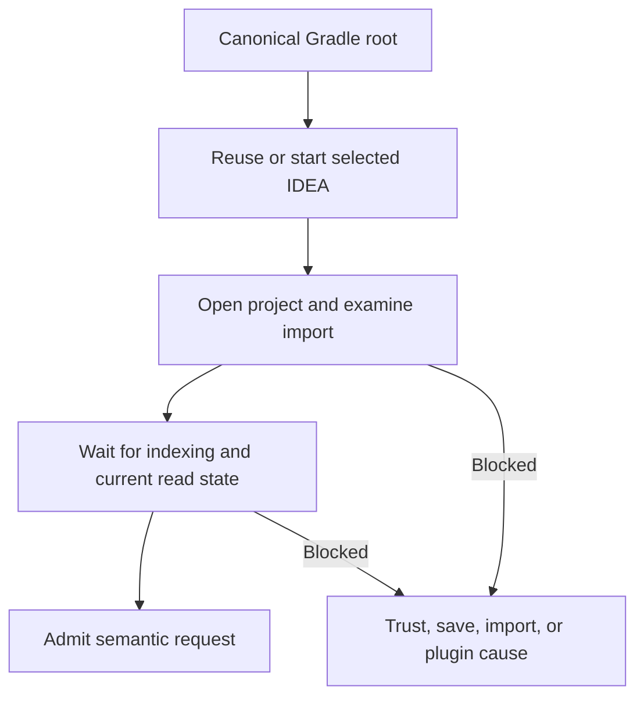

<a id="control-when-an-agent-uses-kast" />

A semantic request needs a compatible, imported, indexed IDEA project for the exact Gradle root. Kast prepares that project when authorized demand needs it.
The plugin's MCP session starts preparation on initialization or its first admitted modern request.
The passive context hook does not prepare projects. It needs no uv environment or third-party Python package.

## What happens on the first question

The coordinator selects the canonical root and requests project preparation. The Host reuses or starts the selected IDEA instance and admits the project.

`WorkspacePreparations` owns one sequence for each root. It opens once and observes the issued operation until readiness or a terminal cause.

Multiple demands can share pending preparation. Later demand can reexamine the Host after a blocked or rejected preparation.

This retry gets current native facts. It does not rewrite historical outcomes or replay earlier semantic operations.

## Readiness and blockers

Import and indexing can make the first call slower. Background presentation is not assured because IDEA can need user attention.

Trust prompts, unsaved documents, incompatible plugins, and failed import keep explicit causes. They cannot become an empty successful query.

Readiness belongs to the exact worktree. A ready project in another worktree cannot supply the requested authority.

## Connection state and project readiness differ

Registration supplies a client adapter. Catalog admission supplies available tool schemas. Neither fact establishes a ready IDEA project.

Each semantic request still needs current read admission. A completed preparation is reusable only while its native authority remains valid.

Disconnection removes recorded integration rather than IDEA state. An already loaded client adapter needs a restart to unload.

Automatic preparation remains part of semantic demand. Kast has no management switch that disables preparation while semantic tools remain enabled.

Hosted `workspace_lifecycle` supplies separate project actions. [Manage Kast](/reference/management#explicit-workspace-control-in-the-hosted-app-server) describes their use.

[Lifecycles](/reference/lifecycles#workspace-preparation-lifecycle) defines preparation ownership and finite lookup history. [The source map](/reference/source-map) identifies its implementation.
