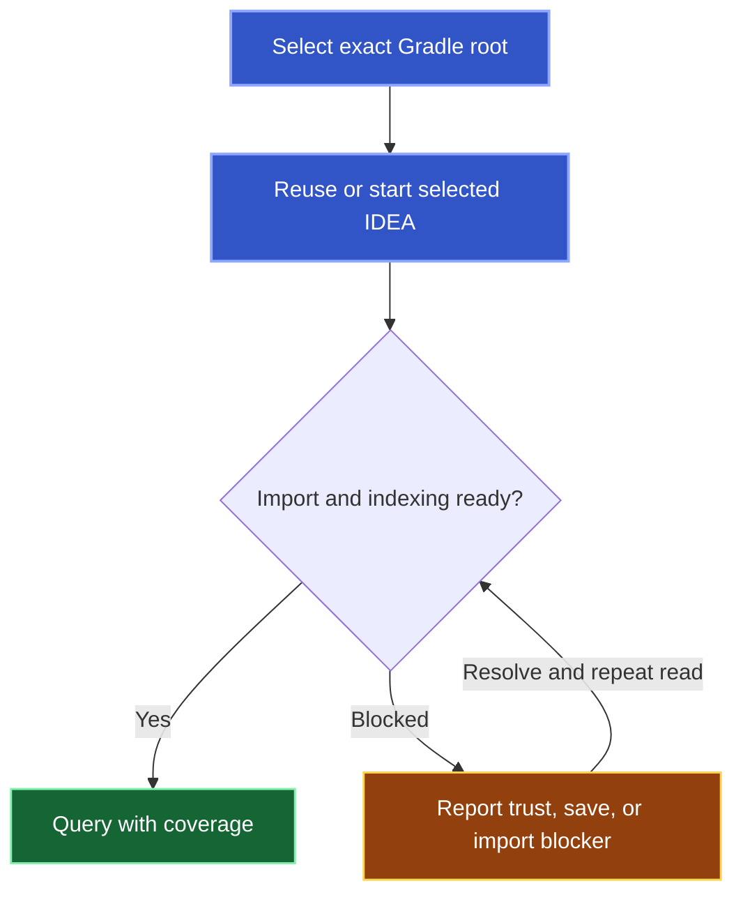

A semantic request needs an imported and indexed IDEA project for one exact Gradle root. Kast prepares that project when the request needs it.

## What happens on the first question

Kast selects the exact Gradle root, reuses or starts IDEA, and waits for import and indexing. Project readiness controls query admission.

The first request can take longer because IDEA needs import and indexing before semantic admission. Background presentation is not assured. A trust prompt, unsaved document, or failed import can need your attention in IDEA.

Results belong to the selected worktree. References from another worktree need their own admission. Use the [first query](/reference/integrations#run-the-first-query) to examine readiness and tool use.

<a id="control-when-an-agent-uses-kast" />

## Connection state and project readiness differ

An installed connection exposes tools. It does not establish IDEA readiness or compiler evidence. A fresh semantic call needs its own project admission.

[Manage Kast](/reference/management) describes disconnection and workspace actions. Disconnection leaves IDEA, existing sessions, and other clients in place.

Semantic queries use automatic preparation. Kast has no management command to disable preparation while those queries remain enabled. Hosted App Server supplies explicit project actions through [workspace lifecycle controls](/reference/management#explicit-workspace-control-in-the-hosted-app-server).
