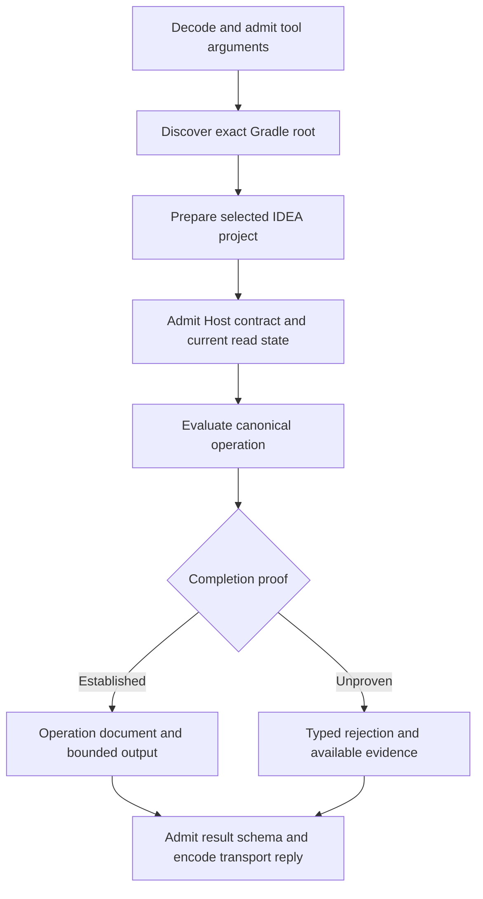

Kast gives a connection, workspace preparation, semantic request, and daemon separate owners. Success establishes the facts of that lifecycle alone.

## Owners and lifetimes

| Owner | Starts with | Ends with | Established fact |
| --- | --- | --- | --- |
| Connection registration | Installation or `kast connect` | Disconnect or removal | A client has an owned adapter or registration. |
| Client session | Client startup and protocol admission | Session exit or retirement | A transport can discover and call its installed tools. |
| Workspace preparation | Demand for one canonical root | Ready, blocked, rejected, or interrupted | The selected IDEA project can reach semantic admission. |
| Semantic request | Input and current-state admission | Complete result, qualification, rejection, or uncertain settlement | Evidence for one operation. |
| Coordinator daemon | Compatible service startup | Stop, replacement, or service exit | Shared service ownership for connected clients and workspaces. |

Readiness does not establish declaration identity. A live socket does not establish a compatible contract. A complete transport exchange does not establish semantic completion.

## Request lifecycle

The direct Tool RPC path supplies a concrete example. Its caller starts in the intended repository directory.

`PublicToolContract` admits public arguments. `HostedCanonicalQuery` connects the selected IDEA project to `CanonicalQueryProtocol`.

The protocol owns semantic page continuation under one admitted grant. Public `RESUME` and `READ_RESULT` only present produced evidence.

Scope, source state, question, and output remain fixed during the run. A failure cannot silently restart discovery under a different question.

### Hosted workspace settlement

The hosted App Server gives each workspace one semantic permit and a bounded queue. Separate workspaces use separate lanes.

Queue wait consumes the interaction allowance. Queue capacity and timeout failures reject before the affected operation starts.

Cancellation before execution records that phase. After execution starts, an uncertain write needs reconciliation before the lane admits another source effect.

An uncertain read does not impose that mutation fence. Bounded state inspection can report the fence while it remains held.

These lane rules describe the hosted App Server. They do not claim one global serialization rule for every Kast transport.

## Connection lifecycle

MCP negotiates a stdio session and advertises tools through `tools/list`. Tool RPC advertises the installed catalog before a one-shot call.

The optional Tool RPC `querySession` capability permits a bounded query conversation in one process. An older catalog without that capability uses one-shot calls.

Hosted App Server admits the client's protocol, thread ownership, and workspace binding before dynamic-tool dispatch. A fresh thread gets the provider catalog.

Disconnect removes the recorded client integration. A client restart unloads its existing adapter. Disconnect does not itself retire the shared daemon or IDEA project.

Upgrades can change schemas and loaded components. New sessions need the new catalog, and IDEA must load the installed Host before semantic admission.

## Workspace preparation lifecycle

`WorkspacePreparations` owns one preparation sequence per canonical root. Multiple demands can share its pending or completed preparation.

The sequence opens the project once, then reads status for the issued operation. Status reads do not repeat the open effect.

Blocked or rejected history does not become permanent readiness authority. A later authorized demand can inspect the current Host and create a new preparation.

Preparation lookup history has a fixed capacity. Retirement preserves held terminal results, but a reclaimed identifier returns `UNKNOWN_OPERATION` on later lookup.

Trust, unsaved documents, incompatible plugins, failed import, and indexing can prevent readiness. [Background preparation](/reference/internals/background-startup) describes the user-facing effects.

## Daemon startup and retirement

Service startup examines the installed executable, selected runtime, configuration, and service identity. A shared installation lock serializes startup and stop.

Readiness records and socket exchange identify the service generation. A stale record or an occupied socket cannot stand for an admitted current service.

Lifecycle fences prevent automatic startup during stop, reset, or payload replacement. Unknown fence state rejects startup.

`kast stop` fences new calls and automatic restart before retirement. Installation recovery replaces payloads only after its shutdown rules succeed.

A daemon restart does not replay writes. A Host restart retires its live authority, so retained output needs a new investigation.

[Manage Kast](/reference/management) gives stop and recovery procedures. [Compatibility](/reference/compatibility) defines component admission.

## Source evidence

[The source map](/reference/source-map#request-connection-and-daemon-ownership) links request dispatch, workspace lanes, preparation, service identity, and lifecycle fences.
