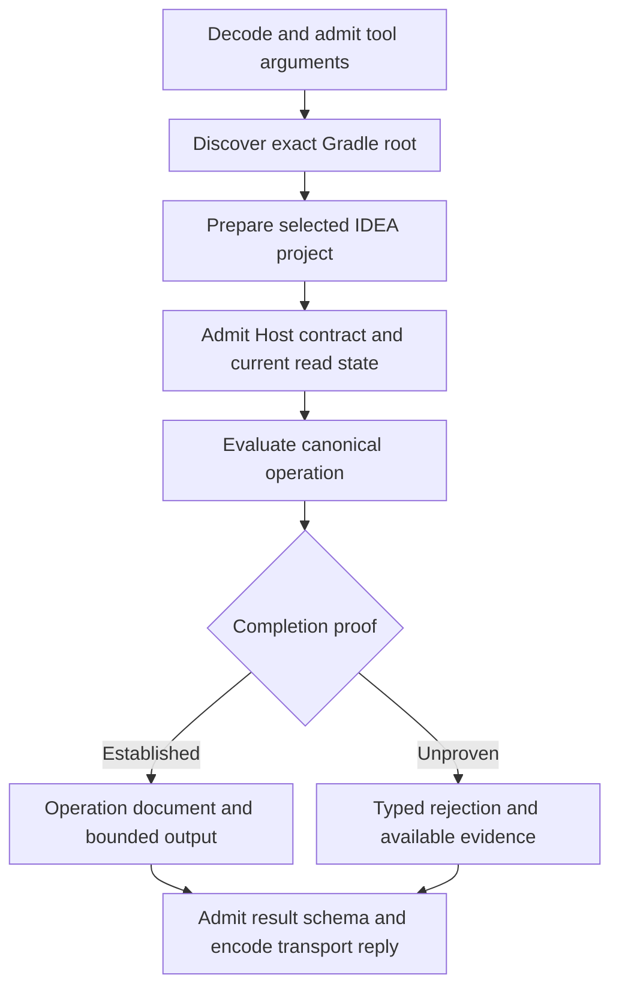

A connection, project preparation, semantic request, and daemon each have their own owner. Success in one lifecycle proves only the facts of that lifecycle.

## Owners and lifetimes

| Owner | Starts with | Ends with | Proved fact |
| --- | --- | --- | --- |
| Connection registration | Installation or `kast connect` | Disconnect or removal | A client has an owned adapter or registration. |
| Client session | The client starts and its protocol is admitted | Session exit or retirement | A transport can discover and call its installed tools. |
| Workspace preparation | Demand for one canonical root | Ready, blocked, rejected, or interrupted | The selected IDEA project can reach semantic admission. |
| Semantic request | Input and current state pass admission | A complete, qualified, rejected, or uncertain result | Evidence for one operation. |
| Coordinator daemon | Compatible service startup | Stop, replacement, or service exit | One service owns work shared by connected clients and workspaces. |

A ready project does not prove a declaration identity. A live socket does not prove that contracts match. A complete transport exchange does not prove semantic completion.

## Request lifecycle

The direct Tool RPC path supplies a concrete example. Its caller starts in the intended repository directory.

1. Tool RPC admits the input and finds the exact Gradle root.
2. Kast prepares the selected IDEA project and checks the Host contract and current read state.
3. The canonical operation runs and checks its completion proof.
4. Both a proved result and a typed rejection pass result-schema checks before the reply.

`PublicToolContract` admits public arguments. `HostedCanonicalQuery` connects the selected IDEA project to `CanonicalQueryProtocol`.

The protocol owns semantic page continuation. It keeps that work under one admitted grant. Public `RESUME` and `READ_RESULT` only show produced evidence.

Scope, source state, question, and output remain fixed during the run. A failure cannot silently restart discovery under a different question.

### Hosted workspace settlement

The hosted App Server gives each workspace one semantic permit and a bounded queue. Each workspace has its own lane.

Queue wait counts toward the interaction allowance. If the queue is full or its wait expires, Kast rejects the affected call before it starts.

If a call is cancelled before it runs, Kast records that phase. After it starts, an uncertain write needs recovery. The lane admits no further source effect until the write is settled.

An uncertain read does not impose that write fence. Bounded state checks can report the fence while it stays held.

These lane rules describe the hosted App Server. They do not mean that all Kast transports run requests one at a time.

## Connection lifecycle

MCP negotiates a stdio session and advertises tools through `tools/list`. Tool RPC advertises the installed catalog before a one-shot call.

The optional Tool RPC `querySession` capability permits a bounded query session in one process. If an older catalog lacks that capability, use one-shot calls.

Before it dispatches a dynamic tool, hosted App Server admits the client's protocol, thread ownership, and workspace binding. A fresh thread gets the provider catalog.

Disconnect removes the recorded client integration. A client restart unloads its existing adapter. Disconnect does not itself retire the shared daemon or IDEA project.

Upgrades can change schemas and loaded components. New sessions need the new catalog. Before a semantic call, IDEA has to load the installed Host.

## How a project gets ready

`WorkspacePreparations` owns one setup sequence per canonical root. Multiple demands can share setup that is pending or complete.

The sequence opens the project once. It then reads status for the issued operation. Status reads do not repeat the open effect.

<AccordionGroup>
  <Accordion title="Preparation and transport deadlines">
Preparation has a 17-minute budget. Opening, import, indexing, and final admission share that budget. Each lifecycle frame has a separate 5-second transport limit. A frame timeout reports `EXCHANGE_DEADLINE_EXCEEDED` with its command, stage, cause, and timing. `HOST_UNAVAILABLE` alone does not prove that IDEA exited. Semantic execution has its own limits after preparation.
  </Accordion>
  <Accordion title="Recovery after a settled import">
After an import settles, a current model observation can still require a reload. The settled refresh then reports `MODEL_RELOAD_REQUIRED`. Preparation can issue one owned recovery reload within its remaining budget. A later input change remains pending until an import covers it. Inspection distinguishes pending input revisions from rejection of the current imported model; retained model evidence describes a previous observation.
  </Accordion>
</AccordionGroup>

A past blocker or rejection does not define readiness forever. A later authorized demand can check the current Host. It can then create a new preparation.

Setup lookup history has a fixed capacity. Retirement keeps final results that are still held. Once an ID is reclaimed, a later lookup returns `UNKNOWN_OPERATION`.

Trust, unsaved documents, plugins that do not match, failed import, and indexing can block readiness. [Background preparation](/reference/internals/background-startup) describes the user-facing effects.

## Starting and stopping a daemon

When a service starts, it checks the installed executable, selected runtime, settings, and service identity. A shared installation lock runs startup and stop one at a time.

Readiness records and a socket exchange identify the service generation. An old record or a socket in use does not prove an admitted current service.

Lifecycle fences block automatic startup during stop, reset, or payload replacement. If the fence state is unknown, startup rejects.

`kast stop` fences new calls and automatic restart before retirement. Installation recovery replaces payloads only after its shutdown rules succeed.

A daemon restart does not replay writes. A Host restart ends its live authority. Retained output then needs a new investigation.

[Manage Kast](/reference/management) gives stop and recovery procedures. [Compatibility](/reference/compatibility) defines component admission.

## Source evidence

[The source map](/reference/source-map#request-connection-and-daemon-ownership) links the code for request dispatch and workspace lanes. It also links project setup, service identity, and lifecycle fences.
