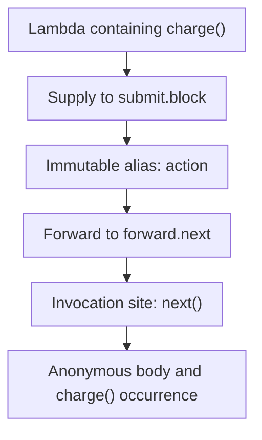

Kast traces relationships between declarations. It also traces transfers inside function bodies. Each path keeps its source sites, compiler identities, and proof still needed.

The body-level trace shows how a value moves through that body. Callback evidence connects that body to its supplier and call owner.

## Three tracing contracts

| Question | Contract | Evidence |
| --- | --- | --- |
| Which declarations connect to this symbol? | `EXPAND_RELATION`, `WALK`, or `TRACE` | References, calls, implementations, overrides, and traversal depth. |
| How does this callback reach a call? | Callback observations within relationship reads | Supply, formal binding, aliases, forwarding, call sites, and callable ownership. |
| Where does this producer value travel? | `IMPACT` with `KOTLIN_FORWARD_V1` | Value paths, representation models, destination sites, terminals, and obligations. |

These contracts share exact identities and source state. Their edges state different facts. A reference count cannot stand for a call count.

## Inside a function body

This source illustrates a callback route. It does not record a Kast response.

```kotlin
fun submit(block: () -> Unit) {
    val action = block
    forward(action)
}

fun forward(next: () -> Unit) {
    next()
}

fun checkout() {
    submit { charge() }
}
```

The compiler maps the supplied lambda to `submit.block`. Immutable value evidence keeps the alias through `action`.

Forwarding evidence connects that formal to `forward.next`. The call of `next()` keeps its actual owner, and the anonymous body keeps `charge()`.



1. The lambda body contains the call to charge.
2. The caller supplies that lambda to submit.block.
3. The immutable action alias keeps the supplied value.
4. Forwarding sends the value to forward.next.
5. The call to next invokes that value.
6. The evidence keeps the anonymous body and its charge call.

An admitted graph keeps proof for each hop. If a transfer is not supported or the scan is incomplete, Kast cannot claim a complete graph.

`checkout` supplies the lambda. Supply alone does not make `checkout` a direct named caller of every call inside that lambda.

## Ownership and execution

Kast keeps five roles distinct: the named lexical container, anonymous body, supplying callable, receiving formal, and actual call owner.

An unused default keeps its formal and expression without an invented call. A nested body needs evidence for its own invocation route.

Kast composes anonymous owners through exact supplier bindings, source summaries, direct calls, and admitted library contracts. Each owner keeps its own proof. Lexical containment alone does not complete a route.

Reviewed calls-in-place contracts keep their declared call kind. Missing effects or effects that conflict cannot become `UNKNOWN`. That value cannot stand in for missing proof.

The reviewed `kotlin.lazy` model records deferred initializer supply. It does not prove that the property was read or that the initializer ran.

[Callback evidence](/reference/callbacks) describes these mechanisms. [Callback observation fields](/reference/callback-observations) defines their encoded variants.

## Producer values and representations

`IMPACT` starts from exact producer calls. Native reads prove source identity and supported Kotlin transfers.

Supplied reviewed models define how values change form and how modeled callables behave. Each path records where a model was used beside the native evidence.

Under normal completion, the final value of a try or catch body can supply the try expression. Each catch alternative keeps its own producer identity.

Throws do not supply a normal result. Transfers across `finally` keep `FINALLY_UNSUPPORTED` because its effect remains outside the supported proof.

The retained witness lists producers, models, native reads, read rejections, and findings. It also keeps the record for each requested site. A site identity alone cannot prove a producer relationship.

[Query forms](/reference/api#investigate-value-impact) defines inputs and witness sections.

## Completion and limits

Every public `RUN` uses `COMPILER_RESOLVED_STATIC_V1` with `COMPLETE_ONLY`. To complete, a run must finish its work and meet its proof rules.

`TRACE` from source symbols separates source completeness from callback execution. Proven nested routes compose without a nesting gap. Unproved owner routes and missing library effects remain explicit evidence gaps under `SOURCE_RELATIONSHIPS`. Kast does not infer an invocation from lexical containment or supply.

Invocation queries still need complete callback graphs. Unresolved source identity, missing result membership, and exhausted grants reject both interpretations. A rejection keeps proved evidence when retention admits it. [Results](/reference/responses#run-completion) defines the rule for composed queries.

The model proves source relationships resolved by the compiler. It does not prove that code ran, that a branch can run, or how often code runs. It does not prove project behavior after an edit.

## Source evidence

[The source map](/reference/source-map#callback-and-deferred-ownership) links callback owners and counterexample tests.

[Value-impact contracts](/reference/source-map#value-impact) identify the owners of paths, models, and investigation accounting.
