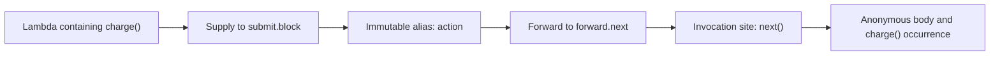

Kast traces relationships between declarations and transfers inside function bodies. Each path keeps its source sites, compiler identities, and unresolved obligations.

The intrafunctional part answers how a value moves through a body. Callback evidence connects that body to its supplier and invocation owner.

## Three tracing contracts

| Question | Contract | Evidence |
| --- | --- | --- |
| Which declarations connect to this symbol? | `EXPAND_RELATION`, `WALK`, or `TRACE` | References, calls, implementations, overrides, and traversal depth. |
| How does this callback reach an invocation? | Callback observations within relationship reads | Supply, formal binding, aliases, forwarding, invocation sites, and callable ownership. |
| Where does this producer value travel? | `IMPACT` with `KOTLIN_FORWARD_V1` | Value paths, representation models, destination sites, terminals, and obligations. |

These contracts share exact identities and source state. Their edges describe different facts, so a reference count cannot stand for an invocation count.

## Inside a function body

This source illustrates a callback route. It does not record a Kast response.

```kotlin
fun submit(block: () -> Unit) {
    val action = block
    forward(action)
}

fun forward(next: () -> Unit) {
    next()
}

fun checkout() {
    submit { charge() }
}
```

The compiler maps the supplied lambda to `submit.block`. Immutable value evidence preserves the alias through `action`.

Forwarding evidence connects that formal to `forward.next`. The invocation of `next()` keeps its actual owner, and the anonymous body keeps `charge()`.



An admitted graph keeps the derivation for each hop. Unsupported transfer or incomplete enumeration prevents a complete graph claim.

`checkout` supplies the lambda. Supply alone does not make `checkout` a direct named caller of every call inside that lambda.

## Ownership and execution

Kast distinguishes the named lexical container, anonymous body, supplying callable, receiving formal, and actual invocation owner.

An unused default keeps its formal and expression without an invented invocation. A nested body needs evidence for its own activation route.

Reviewed calls-in-place contracts preserve their declared invocation kind. Missing or contradictory effects cannot become `UNKNOWN` as a substitute for absent proof.

The reviewed `kotlin.lazy` model records deferred initializer supply. It establishes neither property access nor initializer execution.

[Callback evidence](/reference/callbacks) describes these mechanisms. [Callback observation fields](/reference/callback-observations) defines their encoded variants.

## Producer values and representations

`IMPACT` starts from exact producer invocations. Native reads establish source identity and supported Kotlin transfers.

Supplied reviewed models define representation changes and modeled callable behavior. Paths keep those model applications beside native evidence.

A final try or catch value can supply the try expression under normal completion. Catch alternatives keep their own producer identities.

Throws do not supply a normal result. Transfers across `finally` keep `FINALLY_UNSUPPORTED` because its effect remains outside the supported proof.

The retained witness exposes producers, models, native reads, read rejections, findings, and requested-site accounting. Site identity alone cannot establish a producer relationship.

[Query forms](/reference/api#investigate-value-impact) defines inputs and witness sections.

## Completion and limits

Every public `RUN` uses `COMPILER_RESOLVED_STATIC_V1` with `COMPLETE_ONLY`. Completion needs exhausted execution and discharged proof obligations.

Mutable or unsupported flow, missing source, unresolved owners, and exhausted grants can prevent completion. A rejection keeps established evidence when retention admits it.

The model establishes compiler-resolved source relationships. It does not establish runtime execution, branch feasibility, execution frequency, or project behavior after an edit.

## Source evidence

[The source map](/reference/source-map#callback-and-deferred-ownership) links callback owners and counterexample tests.

[Value-impact contracts](/reference/source-map#value-impact) identify the owners of paths, models, and investigation accounting.
