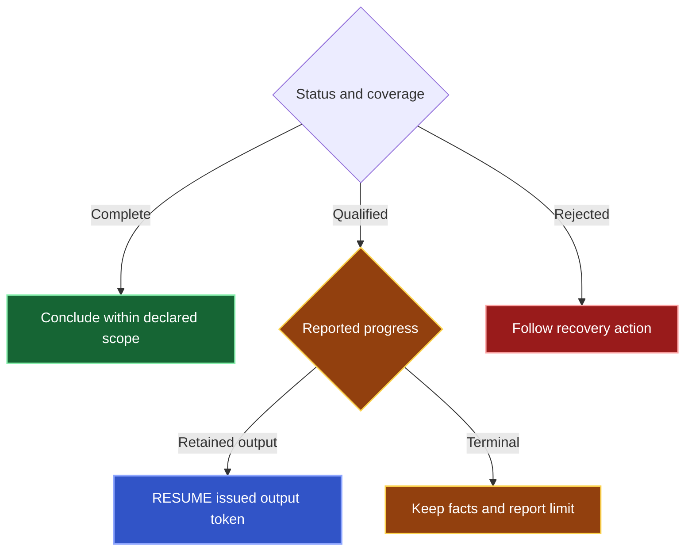
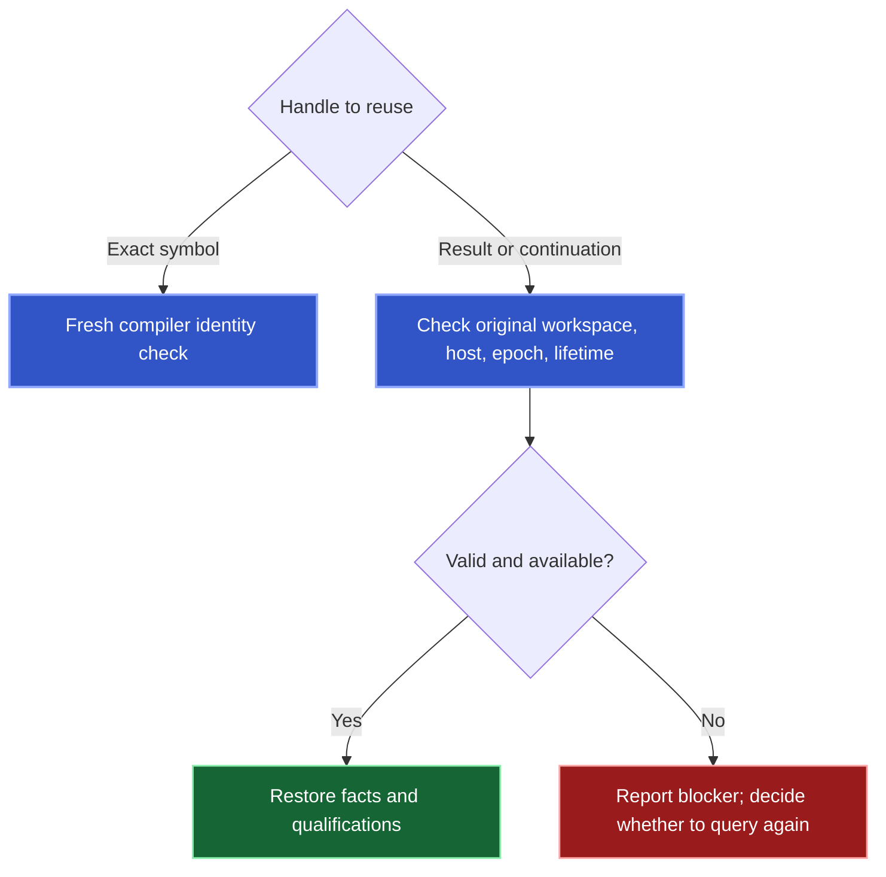

Read coverage and progress before you use a query's facts. A successful transport call does not alone establish semantic completion.

<a id="interpret-coverage-before-making-a-claim" />

## Read coverage before a claim

The document's status identifies the strength and limits of its answer:

| Status | Meaning |
| --- | --- |
| `complete` | Declared scope covered. |
| `qualified` | Stated limitations or unfinished work remain. |
| `rejected` | Input or state requirements prevented completion. |

Established rows keep their value with their qualifications. Empty qualified results do not prove absence. [Query forms](/reference/api#choose-the-result-you-need) defines symbol, occurrence, traversal, binding, and impact outputs.

Diagnostics cover the reported IDEA scope. Source changes need separate [verification and recovery evidence](/reference/change#read-the-receipt).

## Read an automatic query

The response shape uses `kast.query.run.v8`. Host and Control must supply the same contract.

For symbols, occurrences, traversal records, or bindings, one `query_symbols` `RUN` drains issued execution pages internally. The call returns accumulated rows in page order with their exact references and multiplicity. An empty page can advance execution. The original query, scope, output, and semantic basis stay fixed.

Every `RUN` uses `COMPLETE_ONLY` within `COMPILER_RESOLVED_STATIC_V1`. A successful answer needs:

- Exhausted execution.
- No item failures or omitted evidence.
- Proven callback graphs.
- Conserved original ledgers for queries that include investigations.

Unsupported questions and missing proof return typed rejections. Saved evidence from a rejection keeps that rejection when you read it.

### Read evidence from a completion rejection

Saved completion evidence includes a bounded `preview`, the original `question`, and a copyable `nextQuery` for `READ_RESULT`. Use `nextQuery` to inspect proven partial facts.

`originalCoverage` keeps the proven minimum, limitations, and original progress. `policyProgress` is `{"type":"EVIDENCE_ONLY"}` and permits presentation of evidence. A historical checkpoint does not authorize more strict execution.

If retention is unavailable, the response names the finite storage cause. It does not invent a result handle. `RETENTION_UNAVAILABLE` preserves complete enumeration when necessary storage fails.

Use the emitted public arguments in `nextQuery`. The saved `question` describes the canonical query. Its source grammar does not replace the public request grammar.

If supplied, `seedQuery` starts a new investigation from proven symbol references in the preview. The selection preserves identity. It does not prove coverage of omitted rows or unfinished scope.

Keep the saved question's scope and each relationship observation's effective domain with its facts. To investigate further, issue a narrower query from reported candidates and scope evidence. Zero proven rows do not establish absence.

<Accordion title="Interpret BYTE_LIMIT_REACHED">
  Encoded response bytes and detached callback-proof storage use separate limits. The final response has an encoded-byte guard. The callback graph builder accounts conservative proof storage against its admitted byte allowance. A small row count does not establish available capacity in either allowance.

  Read the finite callback failure cause, scan state, and obligations with the returned-byte execution grant. The public callback evidence does not expose numeric storage accounting.

  The IDE diagnostic `kast_semantic_read` receipt records the actual retention allowance, admitted accounting, and accounting needed by the rejected request. It also records the latest byte-rejection snapshot and finite decision counters.

  These values describe conservative proof storage. They do not measure heap use or encoded output size. Independent ledgers remain separate. A later successful try does not erase the latest byte-rejection snapshot.
</Accordion>

The fixed compiler-static model does not prove runtime activation or path feasibility. `RUN` rejects a supplied `completion` field.

The invocation shares one allowance for elapsed time, work, and retention. It stops when work finishes or needs a new decision. Reasons include a budget increase, invalid state, or a terminal limit. Stale state and hard timeout do not restart discovery.

Strict `VALUE_PATHS` drains issued continuations against one original investigation ledger. Strict `IMPACT_WITNESS` from `IMPACT` completes that investigation before it presents a saved section. `RESUME` presents produced output. `READ_RESULT` presents saved evidence without semantic replay. A rejection's historical checkpoint grants no new execution allowance.

### Read rows and evidence pages

The invocation reports row counts, preview size, and output positions:

| Response field | Meaning |
| --- | --- |
| `invocation.accumulated_row_count` | Rows accumulated across admitted execution pages. |
| `invocation.preview.type` | `INLINE` includes every accumulated row. `PREFIX` includes an ordered preview. |
| `invocation.preview.row_count` and `encoded_bytes` | Actual preview rows and UTF-8 bytes of the encoded `items` array. |
| `invocation.stop.type` | Typed reason for the stop, with evidence for a failure. |
| `retention` and `next_cursor` | Issued result reference and position for more saved rows. |
| `evidence_window` | Independent evidence positions: `start`, `end`, and `total`. `MORE` means evidence remains. `FINAL` reaches the saved end. |

Small results appear inline. Larger results include a preview with row and byte limits. If retention succeeds, they also include a saved-result reference. To get more rows without semantic replay, use `READ_RESULT` with that reference and cursor.

Accumulated failures, omissions, and observations also use bounded pages. If `evidence_window.type` is `MORE`, set `READ_RESULT.evidence_cursor` to `evidence_window.end`.

Evidence uses a fixed sequence: failures, omissions, walk observations, reference observations, discovery observations, and relation observations. Track row and evidence positions separately. After the last row, keep `cursor` at `invocation.accumulated_row_count` as you advance the evidence cursor. An evidence-only page leaves the row cursor unchanged.

Impact completion needs original ledger conservation and discharged obligations. Selected preview paths and witness sections keep that proof through accounting and a saved presentation window. `INVESTIGATION_UNPROVEN` distinguishes missing original evidence, incomplete path selection, and unresolved necessary obligations. A saved read keeps the original question across witness sections and expanded value paths.

Coverage describes semantic execution. Preview truncation describes presentation. A complete saved result remains complete when the preview omits rows. Every saved page keeps terminal upstream limitations.

If necessary query retention fails, a typed completion rejection preserves the original coverage and actual storage cause. Hosted output fitting can qualify presentation. It keeps the saved result and its original coverage.

## Follow progress, not row count

Use coverage and reported progress to choose the next action. The row count alone cannot establish completion or available output.



An empty saved page can advance evidence. Use the issued `next_action`. If the response requests a budget increase, make a new decision. A result limit alone does not establish a usable output token. `retention_unavailable` keeps a useful prefix but reports loss of the remaining output.

| Operation | Advances | Handle |
| --- | --- | --- |
| `RESUME` | Presentation of already-produced output | Issued `query-output:v1` token |
| `READ_RESULT` | Presentation of stored rows and evidence | Result reference with independent row/evidence cursors |

Every saved page keeps the original coverage. Public `RUN` needs complete execution. Public `RESUME` presents output without visits to unexamined files or continuation of a semantic scan.

Exact-name discovery collects candidates within work and byte allowances. Output row limits control presentation separately. For example, five admitted candidates can appear as pages of two, two, and one. Native discovery limits can still leave coverage incomplete.

Reuse of an issued output token returns stored output without semantic execution or renewed expiry. Stale or unavailable saved state blocks that reuse.

## Carry the correct handle forward

Each handle permits a specific operation. Select it by purpose:

| Handle | Use |
| --- | --- |
| Exact symbol `ref` | Fresh `SYMBOL_REFS` query with current identity checks. |
| Retained-result reference | `RESULT`, composition, or `READ_RESULT`. |
| Row ID | Select a row from its owning result. |
| Issued output continuation | Output-only `RESUME`. |
| Result cursor | Page stored rows. |

Pass each handle unchanged. Token spelling, names, and locations do not establish semantic identity. Row selection keeps evidence but does not prove coverage of excluded rows. Retention failure can prevent reuse while returned facts remain useful.

## Compact and detailed output

By default, output is compact. To include execution details, set `verbose: true`:

```json
{
  "request": {
    "type": "RUN",
    "source": {"type": "SEARCH_DECLARATIONS", "declarationName": "QueryStepSyntax"}
  },
  "verbose": true
}
```

Compact output keeps facts, coverage, limitations, references, continuation, and recovery evidence. The `verbose` field accepts only a boolean.

`knownMinimum` counts logical final output, including delivered rows. Remaining pages and unfiltered provider candidates use different counts.

## Saved state and identity

Exact symbols can undergo fresh compiler revalidation. Saved results and continuations need the workspace, host, read state, and lifetime from their original read.



Saved results and continuations cannot migrate to another read state. Changed epochs, different owners, expiry, or eviction prevent reuse.

Composition keeps input qualifications. Before `DIFFERENCE` or an `ANTI` join can establish absence, the `right` input must have complete coverage.

<Accordion title="Where the operation document sits in each transport">
  Direct MCP places the canonical semantic document in `result.structuredContent`. `health_check` uses a separate readiness shape. Tool RPC document variants carry `document`. Completed invocations in hosted App Server also carry `document`.

  Use the [MCP](/reference/mcp-catalog) or [Tool RPC](/reference/rpc-catalog) wrapper for transport decoding. Decode each operation document with its [generated schema](/reference/schemas).
</Accordion>
