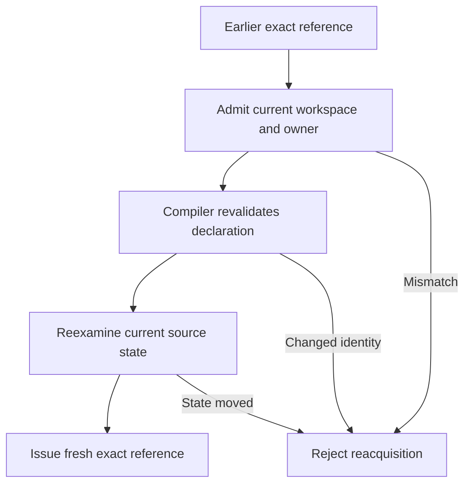

Kast binds semantic evidence to one workspace root, IDEA owner, read epoch, and source state. A later request must establish the facts its action needs.

A path or signature can help find a declaration. Neither value grants authority to reuse an earlier answer.

## What can change the read state

| Signal | Meaning |
| --- | --- |
| Workspace model | The captured imported model changes. |
| Project or Gradle root | The admitted project identity changes. |
| Import state | Gradle import state changes. |
| PSI | IDEA records a source-model change. |
| VFS | A file event belongs to the selected root. |
| Root model | Source roots or dependencies change. |
| Indexing | IDEA enters or leaves an indexing cycle. |

The read epoch is an opaque snapshot of these signals. Equality does not replace content or compiler identity admission.

Kast also examines committed documents and request-specific source evidence. Unsaved documents or an unavailable project can reject admission before semantic work.

An IDEA restart changes the live owner. Another worktree remains another workspace, even when both contain the same commit.

## Exact references can get fresh authority

Exact-reference reacquisition preserves a locator for the original declaration. Kast examines the workspace and owner before compiler revalidation.

The compiler must establish the declaration under current authority. Kast examines that authority again before it issues the fresh reference.

The policy for a local declaration needs unchanged owning-file content. After a local edit or move, discovery must establish a new identity.

`reference_acquisitions` reports reacquisition when the operation supplies it. A different opaque token alone does not prove a source change.

## Retained evidence needs its original state

| Handle | Reuse rule |
| --- | --- |
| Exact reference | Current identity admission can establish a fresh reference. |
| Anonymous `candidateSelector` | Anchored source reads need its admitted source state. |
| Retained result reference | The original workspace, owner, read state, and lifetime must remain available. |
| Output continuation | The original produced output and authority must remain available. |
| Row ID | The owning retained result must match. |
| Result or evidence cursor | The cursor selects a position within its identified result. |

Retained results contain immutable rows and evidence. Kast does not move them to a new epoch or rerun their producer during presentation.

Expiry, eviction, owner retirement, incompatible identity, or changed source state can block reuse. A larger grant cannot restore missing state.

## Rejection and recovery

`FRESHNESS_REJECTED` identifies failure to establish the needed read state. Its stage and finite reason distinguish model admission from later content revalidation.

The returned action can direct a fresh read or new authority admission. The client must preserve that cause and use newly issued handles.

A new `RUN` establishes a new answer. It cannot restore the exact output delivery from a retired result.

For writes, staleness also protects the planned preimage. A lost response needs source-effect recovery before another write.

[Results](/reference/responses#saved-state-and-identity) defines handle use. [Troubleshooting](/reference/troubleshooting) gives recovery procedures.

## Source evidence

[The source map](/reference/source-map#staleness-and-reacquisition) links epoch signals, freshness admission, compiler reacquisition, and rejection tests.
