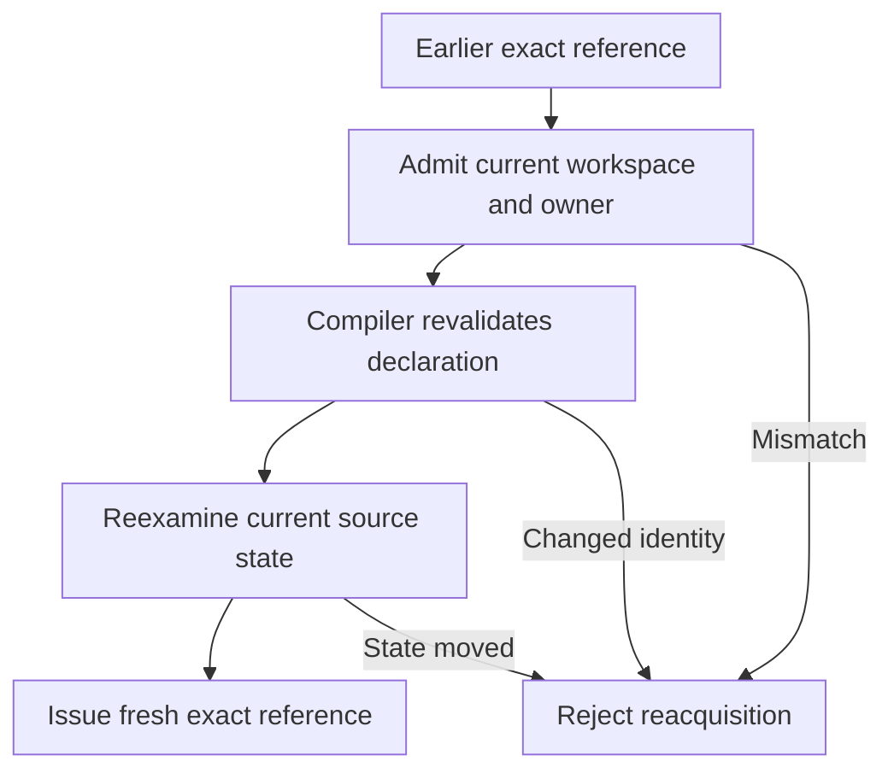
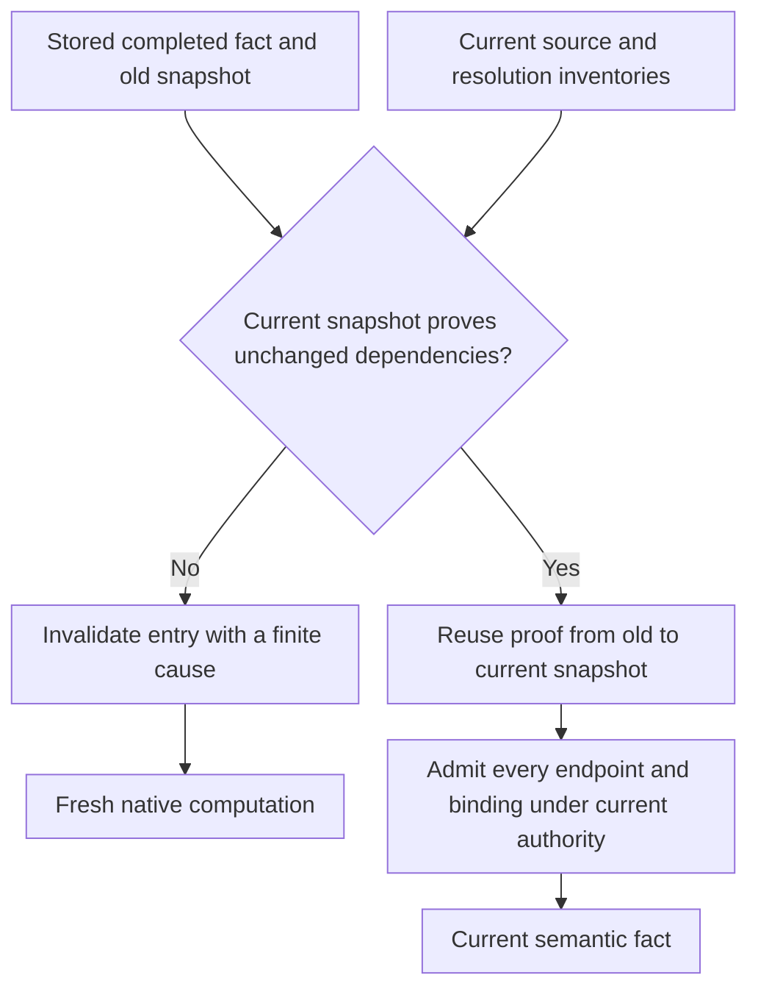

Semantic evidence belongs to one workspace root, IDEA owner, read epoch, and source state. A later request needs fresh proof of the facts its action requires.

A path or signature can help find a declaration. Neither value grants authority to reuse an earlier answer.

## What can change the read state

| Signal | Meaning |
| --- | --- |
| Workspace model | The captured imported model changes. |
| Project or Gradle root | The admitted project identity changes. |
| Import state | Gradle import state changes. |
| PSI | IDEA records a source-model change. |
| VFS | A file event belongs to the selected root. |
| Root model | Source roots or dependencies change. |
| Indexing | IDEA enters or leaves an indexing cycle. |

The read epoch is an opaque snapshot of these signals. Equal epochs do not replace checks of content and compiler identity.

Kast also checks committed documents and the source evidence needed for a request. Unsaved documents or a missing project can block admission before semantic work.

An IDEA restart changes the live owner. Another worktree remains another workspace, even when both contain the same commit.

## Exact references can get fresh authority

To reacquire an exact reference, Kast keeps a locator for the original declaration. It checks the workspace and owner before it asks the compiler to revalidate the identity.

The compiler proves the declaration under current authority. Kast checks that authority again before it issues the fresh reference.

1. Admit the current workspace and IDEA owner.
2. Revalidate the original declaration with the compiler.
3. Check source state again before issuing a fresh exact reference.
4. Reject reuse if identity or state cannot be proved.

For a local declaration, the owning file has to stay unchanged. After a local edit or move, use discovery to prove a new identity.

`reference_acquisitions` reports reacquisition when the operation supplies it. A different opaque token alone does not prove a source change.

## Retained evidence needs its original state

| Handle | Reuse rule |
| --- | --- |
| Exact reference | Current identity checks can prove a fresh reference. |
| Anonymous `candidateSelector` | Anchored source reads need its admitted source state. |
| Retained result reference | Reuse needs the original workspace, owner, read state, and valid lifetime. |
| Output continuation | Reuse needs the original produced output and authority. |
| Row ID | The owning retained result must match. |
| Result or evidence cursor | The cursor selects a position within its identified result. |

Retained results hold rows and evidence that cannot change. Kast does not move them to a new epoch. Reading their output does not rerun the producer.

Expiry, eviction, or owner retirement can block reuse. So can identity that does not match or source state that has changed. A larger grant cannot restore missing state.

## Rejection and recovery

`FRESHNESS_REJECTED` means that the needed read state was not proved. Its stage and specific reason show whether the model admission or a later content check failed.

The returned action can call for a fresh read or new authority checks. The client keeps that cause and uses newly issued handles.

A new `RUN` produces a new answer. It cannot restore the exact output from a retired result.

For writes, staleness also protects the source state in the plan. If a response is lost, check the source effect and recovery state before another write.

[Results](/reference/responses#saved-state-and-identity) defines handle use. [Troubleshooting](/reference/troubleshooting) gives recovery procedures.

## Incremental facts need new authority

Some completed semantic facts can survive a source-state change. They follow a different rule from retained query answers.

`SemanticCallbackFactStore` keeps bounded, detached callback summaries, supplier inventories, and named-relation facts under the project owner.

Its dependency snapshot records source inventories and resolution inputs. Equal paths, SDK names, or modification counters cannot prove equal content.

The comparison needs continuity of the live environment. It also needs matching resolution inputs, dependency domain, and source content.

Even with that proof, old endpoints remain stale until current admission succeeds. The reuse proof never renews an old lease or continuation.

<Accordion title="Changes that reject incremental reuse">
  - A source inventory changes or its dependency domain differs.
  - The SDK, compiler configuration, or `classpath` changes.
  - The live environment loses continuity or its project owner retires.
  - A saved fact refers to source outside the admitted inventory.

  A rejected comparison invalidates the stored entry. Fresh computation still needs complete, admitted evidence before optional publication.
</Accordion>

An unchanged dependency set can permit fact reuse while an old query-result handle still rejects. Those objects have different validity rules.

[Query reuse](/architecture/query-reuse) covers shorter lifetimes within one invocation. [Topology](/architecture/topology#state-owners-and-lifetimes) compares their owners.

## Source evidence

[The source map](/reference/source-map#staleness-and-reacquisition) links the code and tests for epoch signals. It also covers freshness checks and how Kast gets fresh compiler identity.

<Accordion title="Incremental reuse owners and tests at 23828e1536">
  - [`SemanticDependencySnapshot`](https://github.com/amichne/kast/blob/23828e1536835b5cae785b30254ac68059705926/topology/contract/src/main/kotlin/io/github/amichne/kast/topology/contract/SemanticDependencySnapshot.kt) owns snapshot comparison and its finite failures.
  - [`SemanticCallbackFactStore`](https://github.com/amichne/kast/blob/23828e1536835b5cae785b30254ac68059705926/topology/build/src/main/kotlin/io/github/amichne/kast/topology/build/SemanticCallbackFactStore.kt) owns bounded publication, lookup, and invalidation.
  - [`SemanticCallbackFactRead`](https://github.com/amichne/kast/blob/23828e1536835b5cae785b30254ac68059705926/topology/build/src/main/kotlin/io/github/amichne/kast/topology/build/SemanticCallbackFactRead.kt) distinguishes a current fact from a fact that still needs admission.
  - [`SemanticDependencySnapshotTest`](https://github.com/amichne/kast/blob/23828e1536835b5cae785b30254ac68059705926/topology/contract/src/test/kotlin/io/github/amichne/kast/topology/contract/SemanticDependencySnapshotTest.kt) covers changed sources, SDK, `classpath`, compiler settings, and owner continuity.
</Accordion>
