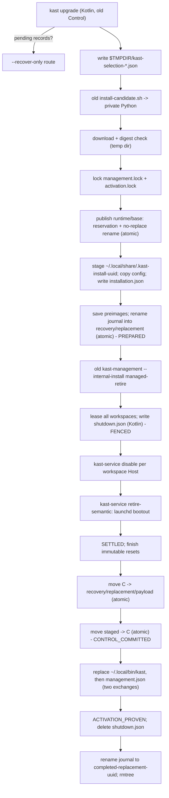

# Installation lifecycle inventory

The evidence supports the hypothesis, with one correction.
The Host runtime half of the product is already content-addressed and immutable.
Its complexity comes from repair-in-place and from removal proofs, not from version switching.
The Control half is replaced in place.
Its mutable client configuration and live coordinator state sit inside the directory being replaced, so every upgrade is a multi-phase move with a journal.
That journal, the shutdown fence, and the uninstall journal each have writers or readers in two languages, and `management.json` has readers in three.
The product lifecycle has 201 `raise ValueError` sites.
Of these, 114 guard an intermediate state of the multi-phase design, 84 guard an external risk, and 3 guard a leftover.
Of the 201 typed Python rejections, 72 are leftovers, mostly in an `installation-lifecycle.py` command surface that no product code calls.
The proposed design keeps immutable version directories, puts configuration and state outside them, and switches versions with one atomic pointer rename, all owned by Go.
It removes the replacement journal, the shutdown fence, and the uninstall journal.
One rule replaces the three replacement recovery routes: run the command again.
It keeps release digest checks, Host and coordinator retirement, and ownership checks on home paths.
I recommend that design, after the pure deletions in [Delete now](#7-delete-now).

## Revision and scope

- Base revision: `914b8905111c9800a8c9647d75592c9d07fb299c` (`origin/main`).
- Sources read: `install.sh`, `packaging/internal/{bootstrap,installation,product}`, `distribution/{contract,managed,cli}/src/main`, the lifecycle-facing parts of `app-server` and `cli`, and `frontend/internal/frontend/control.go`.
- Method: source reading and reference search. No test, build, or native lifecycle run supports any claim in this report.
- Citations use repository-relative paths. `R` is `~/.local/share/kast`; `C` is `R/installation`, the Control payload.
- Counts come from `grep` over the named files at the base revision. Groupings are my classification; the text marks each judgment.

## 1. Records

### Control and product records

| Record | Path | Schema | Writers | Readers | Lifetime | Guards against |
| --- | --- | --- | --- | --- | --- | --- |
| Payload manifest | `C/installation.json` | 3 written; 1, 2, 3 read | Python `activate` (`packaging/internal/product/managed_product_installation.py:625-636`) | Python `Installation.admit` (`packaging/internal/installation/installation-lifecycle.py:417-443`), `managed_payload` (`installation-recovery.py:320-357`), removal (`managed_product_removal.py:112-127`); Kotlin `BundledManifest` (`distribution/cli/.../BundledManifest.kt:12-42`), `RecordedControlManifest` (`RecordedRecoveryInstaller.kt:144-151`), `cli/.../installation/InstallationManifest.kt:7-21` | One Control payload | Changed or partial payload bytes; payload moved to another path |
| Management receipt | `R/management.json` | 3 | Python `resume_locked` (`managed_product_installation.py:954-973`) | Python `read_management` (`managed_product_installation.py:528-546`), removal (`managed_product_removal.py:101-110`); Kotlin `ManagementReceiptAdmission.kt:42-71`; Go `runtimeHome` (`frontend/internal/frontend/control.go:97-121`) | Install to uninstall | Public executable replaced by a foreign file |
| Product selection | `C/share/kast/product-selection.json` | `ProductReference` 1 | Python `activate` (`managed_product_installation.py:606-607`) | Python `reference_at` (`managed_product_installation.py:262-297`); Kotlin `InstalledProductSelection.read` (`InstalledProductRuntime.kt:125-135`) | One Control payload | Payload bound to another build record or runtime |
| Build record copy | `C/share/kast/build-record.json` | release record | Python `activate` (`managed_product_installation.py:604-605`) | Python `reference_at`, `reset_preflight` (`immutable_store.py:506-508`); Kotlin `InstalledProductRuntime` | One Control payload | Offline repair without the release |
| Public executable | `~/.local/bin/kast` | bytes of `C/share/kast/libexec/kast-management` | Python `resume_locked` copies the bytes (`managed_product_installation.py:960-973`) | Go `locateInstallation` (`control.go:76-95`); Kotlin uninstall (`ManagementUninstall.kt:244-258`) | Install to uninstall | Foreign `kast` on `PATH` |
| Captured selection | `$TMPDIR/kast-selection-*.json` | `ResolvedBuildSelection` | Kotlin `executeManagedUpgrade` (`ManagedUpgrade.kt:96-98`) | Python `decode_selection` (`managed_installation.py:505-506`, `managed_release.py:1027-1074`) | One upgrade | Release catalog changing between Kotlin and Python resolution |
| Capability markers | `C/share/kast/managed-install-v1`, `lifecycle-fence-v1`, `reset-fence-v1`, `install-completion-v1` | `1\n` | Bootstrap generator (`packaging/internal/bootstrap/generate_bootstrap.py:87-90`) | `managed_release.py:1538`, `RecordedRecoveryInstaller.kt:224`, `InstallationLifecycle.kt:235-237`, `InstallationResetFence.kt:9`; `install-completion-v1` has no reader | One Control payload | An older payload that cannot perform the protocol |

### Replacement transaction records

| Record | Path | Schema | Writers | Readers | Lifetime | Guards against |
| --- | --- | --- | --- | --- | --- | --- |
| Replacement journal | `R/recovery/replacement/receipt.json` | `Replacement` 1; stages and phases below | Python only: `activate` (`managed_product_installation.py:660-689`), `retire_prior` (`:1027`, `:1064`, `:1072`), `resume_locked` (`:951`, `:980`) | Python `managed_installation.py:486-491`, `managed_product_installation.py:839-843`; Kotlin `RecordedRecoveryInstaller.kt:70-88`, `ManagementStatus.kt:161-172` | One upgrade | Interruption between preparation and activation proof |
| File preimages | `R/recovery/replacement/{management,command}-preimage` | raw bytes, digest and mode in the journal | Python `saved_file` (`managed_installation.py:293-305`) via `prepared_preimage` (`managed_product_installation.py:801-808`) | Python `resume_locked` (`:912-922`), `replace_file` (`managed_installation.py:336-388`) | One upgrade | Losing the prior receipt or executable after an interrupted overwrite |
| Prior Control slot | `R/recovery/replacement/payload` | the moved prior `C` | Python `managed_move` (`managed_product_installation.py:943-945`) | Python `managed_previous` (`installation-recovery.py:360-372`) | Control move to journal close | A prior payload neither active nor retired |
| Staged Control | `~/.local/share/.kast-install-<uuid>` | full payload | Python `activate` (`managed_product_installation.py:583-636`) | Python `resume_locked` (`:878-888`); Kotlin `RecordedRecoveryInstaller.kt:98-110` | Preparation to Control move | Publishing a partly extracted payload |
| Completed journal | `R/recovery/completed-replacement-<uuid>` | renamed journal directory | Python `close_managed_journal` (`installation-recovery.py:415-427`) | Same function | Moments | Deleting the only durable receipt before completion is durable |
| Immutable reset plan | `R/recovery/replacement/immutable-reset/receipt.json` and ready trees | `ResetPlan` | Python `prepare_resets` (`immutable_store.py:420-483`) | Python `reset_preflight`, `finish_resets` (`immutable_store.py:486-607`) | One repair upgrade | Interrupted in-place repair of a damaged digest entry |
| Shutdown fence | `R/shutdown.json` | `InstallationShutdownRequest` 1 | Python first install (`managed_product_installation.py:1012-1019`); Kotlin `InstallationLifecycle.fence` (`InstallationLifecycle.kt:132-145`) | Python `managed_shutdown_fence` (`installation-recovery.py:375-394`); Kotlin `admitExistingFence` (`InstallationLifecycle.kt:148-167`), `InstallationLifecycleFence.kt:24-25`, `ManagementStatus.kt:163`, `UninstallManagedRoot.kt:136-152` | Retirement to activation proof | New Host or coordinator starts during a switch |
| Locks | `R/management.lock`, `R/activation.lock` | empty files | Python `flock` on `management.lock` (`managed_installation.py:125-135`), `lockf` on `activation.lock` (`installation-recovery.py:305-317`); Kotlin `FileChannel.tryLock` (`ManagementFileLock.kt:10-33`) | Same | Process lifetime | Two lifecycle operations at once |

### Immutable store and uninstall records

| Record | Path | Schema | Writers | Readers | Lifetime | Guards against |
| --- | --- | --- | --- | --- | --- | --- |
| Runtime entry | `~/.local/share/kast-workspaces/runtimes/<archive-sha>/` with `manifest.json`, `runtime.json`, `host/.../kast-headless.json`, `provenance/{archive.zip,build-record.json,qualification.json,provenance.json}` | `RuntimeReceipt` 1, `Provenance` 1, `AssemblyRecord` 1 | Python `prepare_runtime`, `publish` (`managed_product_installation.py:143-209`, `immutable_store.py:206-231`) | Python `read_runtime`, `admit` (`managed_product_installation.py:111-127`, `immutable_store.py:295-348`); Kotlin workspace generations (`ContainerModel.kt:51-56`) | Until uninstall | Damaged or foreign runtime bytes; repair and removal without the release |
| Base entry | `~/.local/share/kast-runtime-bases/<sha>/` | same provenance set | Python `prepare_base` (`managed_product_installation.py:212-259`) | Python | Until uninstall | Same |
| Publication reservation | `.kast-runtime-*/publication.json`, `.kast-base-*/publication.json` | `Publication` | Python `publication` (`immutable_store.py:660-694`) | Python `recover_publications`, `clean_publication` (`immutable_store.py:697-808`) | One publication | Unknown partial trees in the store after a crash |
| Uninstall journal | `~/.local/share/.kast-uninstall-<sha256(R)>.json` | phases `REMOVAL_REQUESTED`, `CONTROL_RETIRED`, `EXTERNALS_CLEANED`; nested `ProductRemovalProof` 1 | Kotlin `persistUninstallRetirement` (`UninstallRetirementJournal.kt:163-208`); Python `commit_control_retirement` (`installation-lifecycle.py:385-409`) via `product_removal_recovery.py:159-161`, `:208-215` | Kotlin `readUninstallRetirement` (`UninstallRetirementJournal.kt:101-115`); Python `admit_uninstall_journal` (`installation-lifecycle.py:337-383`) | One uninstall | Removal interrupted after Hosts or the payload are gone |
| Retained execution bundle | `R/recovery/installation/product-removal/{control,evidence}` | copied payload and provenance snapshots | Python `product_removal_recovery.prepare` (`product_removal_recovery.py:123-221`) | Python `execution`, `preflight` (`:91-120`, `:224-290`); Kotlin `retainedProductInstaller`, `cleanupProductRemoval` (`UninstallManagedRoot.kt:155-199`) | One uninstall | Python removal code deleting itself mid-removal |
| Recovery bundle | `R/recovery/installation/{receipt.json,*.py}` | `RecoveryReceipt`, `LegacyRecoveryReceipt` | Kotlin `prepareInstallationRecovery` (`InstallationRecoveryReceipt.kt:253-298`), which has no production caller | Kotlin `admitRecoveryRemoval` (`InstallationRecoveryRemoval.kt:16-75`); Python `decode_recovery_proof` (`installation-lifecycle.py:316-335`) | None today | An earlier plugin-replacement design |
| Reset fence | `~/.local/share/.kast-reset-<digest32>.json` | `InstallationResetRequest` 1 with storage `FENCED`, `RETAINED`, `ACTIVATING`, `ERASED` | Kotlin force reset (`ForceResetFence.kt:34-41`, `InstallationResetFence.kt:13-44`) | Kotlin, `app-server/.../InstallationLifecycleFence.kt:37-45`, `cli/.../direct/InstalledToolAdmission.kt:21` | One forced reset | Interrupted `kast uninstall --force` |

### Mutable state inside the replaced payload, and external effects

| Record | Path | Writers | Readers | Guards against |
| --- | --- | --- | --- | --- |
| Client configuration | `C/config/environment`, `C/config/workspaces/<64 hex>/environment` | Kotlin `WorkspaceOverlayFile.kt:23`; Python copies both into each new payload (`managed_product_installation.py:462-483`) | Kotlin configuration ingress; Python `verify_client_configuration` (`managed_product_installation.py:370-393`) | Losing user configuration on upgrade |
| Installation epoch | `C/state/epoch.json` | Kotlin `BrokerInstallationState.admit` (`app-server/.../BrokerInstallationState.kt:44-60`) | Kotlin; dead Python reader (`installation-lifecycle.py:1165-1191`) | Stale semantic thread bindings after a reset |
| Coordinator socket state | `C/state/run/{c.sock,c.sock.lock,endpoint-alias.json,one-shot/,tool-sessions/}` | Kotlin coordinator | Python `empty_invocation_directories` (`product_state_removal.py:74-106`); `managed_tree` admits only `state/run/c.sock` (`installation-recovery.py:235-277`) | Switching under an unsettled invocation |
| Coordinator profiles | `C/state/broker/<16 hex>/{semantic-service.log,semantic-service.plist,service-start.lock,service-readiness.json}` | Kotlin `app-server` | Python `admit_live_semantic_broker` (`managed_product_installation.py:396-438`) | Moving a payload that a coordinator still owns |
| Semantic launchd job | `semantic-service.plist` in the profile above; label `io.github.amichne.kast.broker.<sha256(codexHome)[:32]>` | Kotlin (`PersistentBrokerService.kt:191-199`, `SemanticLaunchdJob.kt:24-40`) | Kotlin | A coordinator surviving its payload |
| Login agent | `~/Library/LaunchAgents/<label>.login.plist` | Kotlin `ServiceLoginAgent.kt:37-60` | Kotlin `AppServerManagement.kt:173-200`, force reset | Coordinator restart at login |
| Socket alias | `/tmp/kast-uds-<digest>` symlink with `state/run/endpoint-alias.json` | Kotlin `InstalledEndpointAlias.kt` | Kotlin; dead Python reader (`installation-lifecycle.py:963-988`) | Socket paths over the platform limit |
| Workspace containers | `~/.local/share/kast-workspaces/containers/<id>/{container.json,generation.json,generation-retirement.json,trust.xml,...}`, `locks/<id>.queries.lock` | Kotlin `ContainerStore.kt:24-26`, `:141-149`, `:200-234` | Kotlin; Python checks only that `containers/` is empty on first install (`managed_product_installation.py:503-525`) | Host retirement and exact-root trust |

### Flags

- **More than one writer:**
  - The shutdown fence and the uninstall journal: Python and Kotlin each write them.
  - The client configuration: Kotlin edits it, and Python copies it into each new payload.
- **Readers in two languages:** the payload manifest, the product selection, and the build record copy.
  The replacement journal, the captured selection, the uninstall journal, the recovery bundle, and coordinator state also have readers in two languages.
- **Readers in three languages:** `management.json` (Python, Kotlin, Go).
- **Disagreeing readers:** Python treats the uninstall journal's `product` as optional (`installation-lifecycle.py:348`, `:361-368`); Kotlin requires it (`UninstallRetirementJournal.kt:35`, `:130-132`).
  Python rejects `EXTERNALS_CLEANED` (`installation-lifecycle.py:355`); Kotlin writes it (`ManagementUninstall.kt:231-237`).
  Python reads the journal only before Kotlin writes that phase, so this mismatch is latent.
  Commit `13d5aa472b` (#1358) fixed the replacement journal case from #1337.
- **Different lock primitives on one file:** Python takes `flock` on `management.lock`; Kotlin takes a `fcntl` record lock through `FileChannel.tryLock`.
  On Linux these two kinds of lock do not exclude each other.
  Kotlin uninstall holds only `management.lock` (`ManagementUninstall.kt:90-92`), so on Linux I expect it not to exclude a concurrent upgrade child. I did not test this.
- **Schema versions or variants that nothing writes:**
  - Payload manifest schemas 1 and 2 (`installation-lifecycle.py:423-443`, `installation-recovery.py:336-339`).
  - `Replacement.composition` and every type it reaches (`managed_update_journal.py:98-166`, `:231-246`, `:263-266`, `:278-284`, `:292-322`).
  - Journal stage `RECOVERY_REQUIRED` and phases `HOST_COMMITTED`, `RESTORING`, and `RESTORED`, in both languages (`managed_update_journal.py:51`, `:257-260`; `InstallationReplacementReceipt.kt:14`, `:56-59`).
  - The legacy recovery receipt (`installation-recovery.py:50-98`, `:229`).
  - The recovery bundle and the `AdmittedRecovery` proof variant.
  - The staged path `R/.install-<uuid>` (`managed_product_installation.py:864`, `RecordedRecoveryInstaller.kt:101`).
  - The candidate `recovery/replacement/rejected-control` (`RecordedRecoveryInstaller.kt:106`).
  - The markers `.recovery-detached` and `.lifecycle-transition.json`, whose only writers have no production caller.

## 2. Transactions

### Install

`install.sh` verifies the private Python archive, its one dependency, and the embedded engine by SHA-256 before any effect (`install.sh:55-73`).
It then runs `bootstrap_entry.py` (`install.sh:76-78`), which calls `managed_installation.main` (`packaging/internal/bootstrap/bootstrap_entry.py:17-19`).

1. Route to recovery if `R/recovery/replacement` or `R/shutdown.json` exists, even without `--recover-only` (`managed_installation.py:481-499`).
2. Resolve the selection and download it into a temporary directory; `download_composition` checks the build record digest (`managed_release.py:1795-1834`). This step has no installation effect.
3. Take `management.lock`, then `activation.lock` (`managed_product_installation.py:561-565`).
4. Publish the runtime and base into the immutable store through a reservation and a no-replace rename (`managed_product_installation.py:143-209`). Each publication is atomic.
5. Stage the Control payload under `~/.local/share/.kast-install-<uuid>`, copy configuration, train the class-data archive, and write `installation.json` (`:581-636`).
6. Save preimages, then publish the journal by a no-replace directory rename (`:642-689`). This rename is atomic; from here on, the journal records each phase.
7. With no prior payload, write `shutdown.json` and record `FENCED` (`:1008-1027`), then record `SETTLED` (`:1068-1072`).
8. Move the staged payload to `C` (`:946-947`), record `CONTROL_COMMITTED` (`:948-951`), and write `~/.local/bin/kast` and `management.json` through `replace_file` (`:960-973`).
9. Record `ACTIVATION_PROVEN`, delete `shutdown.json`, and close the journal (`:978-986`).

The installer leaves the Host stopped (`ProductInstalled.hostState`, `managed_product_installation.py:71`).

### Upgrade and repair

`kast upgrade` runs the active payload's `share/kast/install-candidate.sh` with a captured selection (`ManagedUpgrade.kt:92-103`, `:207-225`).
The previous version's Python code therefore installs the next version.
`--repair` selects the installed product again (`InstalledProductRuntime.kt:205-230`); damaged immutable entries then take the reset path (`immutable_store.py:403-417`, `:420-483`).

Steps F, H, K, and L are single atomic renames.
The steps between them leave state that only the journal explains:

- A staged payload beside the old one, after H.
- A fence with stopped Hosts, after I1.
- No payload at `C`, between K and L.
- A new payload with the old receipt and executable, between L and M.
- An unfenced new payload with the journal still present, between N and O.

Step M replaces two files in sequence, so a crash between them leaves an executable and a receipt from different versions.
`replace_file` handles that case with a preimage and an exchange (`managed_installation.py:336-388`).

Retirement runs the prior Control's Kotlin code.
`retireManagedProduct` leases every workspace container and writes the fence inside the lease (`ManagedWorkspaceRetirement.kt:6-38`, `:62-79`).
It then stops each Host with `kast-service disable` (`ContainerManagement.kt:45-68`) and retires the coordinator with `kast-service retire-semantic` (`InstallationLifecycle.kt:48-57`).
That command removes the launchd job (`SemanticLaunchdJob.kt:24-40`).

### Uninstall

`kast uninstall` takes the workspace store removal lease (`ManagementUninstall.kt:13-31`).

1. Admit the recovery bundle proof, retire every Host and the coordinator under the fence, and capture workspace removals (`ManagedWorkspaceRemoval.kt:22-62`).
   Then write the uninstall journal as `REMOVAL_REQUESTED` (`ManagementUninstall.kt:143-155`).
2. Remove workspace profiles (`:155`).
3. Under `management.lock`, run `install-candidate.sh --remove-product` (`:80-92`). The Python removal goes through these phases:
   - Record `ProductRemoval` as `PREPARING` (`product_removal_recovery.py:136-162`).
   - Copy the payload and every immutable entry's provenance into the retained bundle (`:171-205`).
   - Record `PREPARED` and `CONTROL_RETIRED` (`:207-215`).
   - Erase immutable entries and the payload (`managed_product_removal.py:148-174`).
4. Back in Kotlin, remove the workspace store, the retained bundle, the recovery directories, and `activation.lock` (`ManagementUninstall.kt:45-50`).
5. Remove `~/.local/bin/kast` and `management.lock`, record `EXTERNALS_CLEANED`, and remove `management.json`, the fence, the empty root, and the journal (`:221-242`).

No step after the journal is atomic as a group.
The retained bundle exists because Python removal deletes the interpreter it runs from (`product_removal_recovery.py:114-120`).

`kast uninstall --force` is a separate reset protocol with its own fence and storage phases (`InstallationResetFence.kt:21-44`, `ForceInstallationReset.kt`).

## 3. Recovery

| Entry point | Code that runs | Accepts | Source |
| --- | --- | --- | --- |
| Public bootstrap | Engine embedded in the `install.sh` you download | Any `recovery/replacement` or `shutdown.json`; resumes product journals and reports `RecoveryRequired` for any other record | `install.sh:26`, `managed_installation.py:481-499` |
| Installed bridge | The active payload's `install-candidate.sh --recover-only` | Same as above | `ManagedUpgrade.kt:75-76`, `:122-151` |
| Recorded recovery installer | The bridge inside whichever of the staged payload, `C`, or `rejected-control` matches the journal identity | A schema 1 journal whose manifest digest and payload inventory match | `RecordedRecoveryInstaller.kt:70-139` |
| Implicit refusal | `activate` rejects new work while a journal exists | Nothing; routes the user to the rows above | `managed_product_installation.py:567-570` |
| Publication recovery | Every install | `.kast-runtime-*` and `.kast-base-*` reservations | `immutable_store.py:697-706` |
| Uninstall resume | `kast uninstall` again | An existing uninstall journal at any phase; `PREPARED` runs the retained bundle | `ManagementUninstall.kt:55-67`, `:110-128` |
| Forced reset | `kast uninstall --force` | Any state, under the reset fence | `ManagementExecution.kt:29-37` |
| No caller | `installation-lifecycle.py recover-read-only`; Kotlin `InstallationRecoveryBaseline` | Uncertain invocations; plugin-era recovery receipts | `installation-lifecycle.py:653-704`, `InstallationRecoveryReceipt.kt:69-111` |

The first three rows resume one journal through one function, `resume_locked`.
Each row reaches it from a different copy of the Python code.
The copies are the engine in the current `install.sh`, the active payload's copy, and the staged payload's copy.
Before `CONTROL_COMMITTED` the active copy is the old version; after it, the new one.
Recovery behavior therefore depends on which copy a route selects, and each copy has to read journals that other versions wrote.
The recorded recovery installer exists only because the installed bridge can disappear when `C` is missing between steps K and L.

## 4. Checks

`raise ValueError` sites in `packaging/internal/{installation,product,bootstrap}` number 208, excluding a comment at `managed_installation.py:179`.
Seven are build-time or contributor-only (`generate_bootstrap.py` with 6, `local_product_install.py:155`); the remaining 201 run in the product lifecycle.
All of them reach `rejection` and report `OWNERSHIP_UNPROVEN` (`managed_installation.py:229-230`).
The class column uses these labels:

- **(a)** an external risk, such as another process, a user edit, or a partial download.
- **(b)** an intermediate state that the multi-phase design creates.
- **(c)** a leftover format, path, or caller.

| Group | Invariant | Sites | Class |
| --- | --- | ---: | --- |
| V1 Release artifact admission | Downloaded record, archives, qualification, catalog, and interpreter match their digests and shapes (`managed_product.py:112-262`, `:352-539`; `managed_product_installation.py:151-154`, `:579-602`, `:710-756`; `managed_release.py:470`; `private_interpreter.py:67-98`; `managed_installation.py:547`) | 52 | (a) |
| V2 Installed immutable content | Published runtime and base bytes, sidecars, and layout are unchanged (`managed_product.py:274-310`; `managed_product_installation.py:116-126`, `:240-247`; `immutable_store.py:364-388`, `:415`, `:901-995`) | 25 | (a) |
| V3 Retained provenance | Each entry's copied build record, qualification, and archive still bind (`immutable_store.py:141-159`, `:211-347`) | 16 | (b): stored only for in-place repair and removal proofs |
| V4 Publication reservations | A crashed publication's partial tree is Kast's own (`immutable_store.py:694-883`) | 18 | (b) |
| V5 Immutable reset | In-place repair of a digest entry is bound to the Control journal phase (`immutable_store.py:446-621`) | 13 | (b) |
| V6 Control journal and staging | Staged and prior payloads, preimages, and phases agree with the journal (`managed_product_installation.py:325`, `:570`, `:589`, `:796`, `:877-941`, `:1083`) | 14 | (b) |
| V7 Duplicated product identity | `product-selection.json`, `build-record.json`, `management.json`, and the executable digest agree (`managed_product_installation.py:267-294`, `:533-545`, `:658`) | 9 | (b); `:536` also tolerates three retired fields, (c) |
| V8 Home path ownership | Private directories, the workspace store, and a foreign `~/.local/bin/kast` (`managed_product_installation.py:83-92`, `:508`, `:522`, `:574`, `:652`) | 6 | (a) |
| V9 Uninstall journal and retained execution | Retained bundle, evidence snapshots, and phases agree (`managed_product_removal.py:56-147`; `product_removal_recovery.py:41-288`; `immutable_store.py:173-193`, `:1013-1024`) | 44 | (b); 2 erasure checks are (a) |
| V10 Invocation directories | A settled invocation directory was not replaced (`product_state_removal.py:133`) | 1 | (a) |
| V11 Codex registration helper | Codex MCP output shape (`codex-mcp-registration.py:15-21`) | 3 | (c) |

Totals for `ValueError`: (a) 84, (b) 114, (c) 3.

Typed Python rejections in the same runtime files also number 201.
This count covers `raise Rejected`, `reject`, `reject_state`, `reject_invocation_state`, `StageRejected`, and `retirement_unproven`.

| Group | Invariant | Sites | Class |
| --- | --- | ---: | --- |
| T1 Lifecycle command with no caller | `installation-lifecycle.py` `inspect`, `reset`, `remove`, `prune`, and `recover-read-only` (`:129-196`, `:547-1065`, `:1074-1347`) | 68 | (c) |
| T2 Uninstall journal decoding | Exact fields and identities (`installation-lifecycle.py:285-410`) | 14 | (b) |
| T3 Payload manifest and inventory | Manifest fields and every payload file digest (`installation-lifecycle.py:411-545`, `:1067-1072`) | 26 | (a); the schema 1 and 2 branches are (c) |
| T4 Journal decoding | Strict `dataclass` decoding and limits (`installation-recovery.py:112-232`) | 17 | (b); the composition and legacy branches are (c) |
| T5 Tree witnesses, moves, fence | A tree digest over each entry's device, inode, owner, and mode holds across each move (`installation-recovery.py:235-427`) | 31 | (b) |
| T6 Journal value validators | `managed_update_journal.py:43-389` | 12 | 5 (a), 3 (b), 4 (c) |
| T7 State admission before replacement or removal | `config`, `state/run`, `state/broker` hold only known entries (`managed_product_installation.py:314-525`; `product_state_removal.py:63-116`) | 17 | (b): needed because mutable state sits in the replaced directory |
| T8 Retirement and fence | Child exit and timeout, fence identity, storage (`managed_product_installation.py:138`, `:997`, `:1048-1066`) | 5 | 4 (a), 1 (b) |
| T9 Immutable store | Damage, reset filesystem, reset fence, publication (`immutable_store.py:397-885`) | 5 | 1 (a), 4 (b) |
| T10 Locks and file exchange | Lock ownership and `replace_file` races (`managed_installation.py:125-388`) | 6 | 2 (a), 4 (b) |

Totals for typed Python rejections: (a) 38, (b) 91, (c) 72.

Kotlin lifecycle rejections, counted as `throw ManagementRejected`, `requireRemoval`, and rejected admissions:

- Uninstall root, journal, and product removal: 66 (`UninstallManagedRoot.kt` 38, `ManagementUninstall.kt` 13, `UninstallRetirementJournal.kt` 12, `ProductRemovalJournal.kt` 3). Mostly (b).
- `RecordedRecoveryInstaller`: 15. All (b).
- Workspace removal: 15 (`ManagedWorkspaceRemoval.kt`, `RejectedWorkspaceRemoval.kt`). These are (a): live Hosts are an external risk.
- `BundledManifest.kt`: 5. (a).
- `--internal-install` protocol: 8.
- Lock acquisition: 3.

## 5. Inherent requirements

Any correct lifecycle must still do the following:

1. Verify every downloaded byte against a digest chain rooted in a trusted record before it can run.
   Today the chain is `install.sh` pins, then the build record digest, then asset digests (`install.sh:55-73`, `managed_release.py:1820-1830`).
2. Stop every workspace Host and the semantic coordinator before the code they run is removed or switched.
   On macOS this includes the launchd job and the login agent.
   Hold off new starts until the switch completes.
3. Keep client configuration (`config/environment`, per-workspace overlays), workspace containers, and exact-root trust across upgrade and repair.
4. Refuse to switch or remove while an invocation is unsettled (`product_state_removal.py:101-102`).
5. Survive power loss at any point: after restart, the installation is the old version, the new version, or a state that one idempotent command finishes.
   No step can depend on knowledge that only the interrupted process had.
6. Never delete or overwrite a path that Kast did not create.
   This covers `~/.local/bin/kast`, a foreign `R`, and `/tmp` aliases.
7. Exclude concurrent lifecycle operations with one lock primitive that every participant uses.
8. Report each rejection as a closed code that names the check, as #1312 requires.
9. Support an offline repair only if the product promises it.
   Today repair re-selects the installed release and downloads it again (`InstalledProductRuntime.kt:205-230`, `managed_installation.py:519-523`), so the retained archive copies are not needed for repair.

## 6. Candidate designs

All three designs keep the immutable runtime and base stores and the workspace container store.
They also keep the Kotlin commands that stop Hosts and the coordinator: `managed-retire`, `kast-service disable`, and `retire-semantic`.

### Design 1: immutable version directories and one pointer, in the current languages

Layout:

- `R/versions/<build-record-sha>/` holds a read-only Control payload.
- `R/current` is a symbolic link to `versions/<sha>`.
- `R/config/` holds client configuration.
- `R/state/` holds coordinator state.
- `~/.local/bin/kast` is a symbolic link to `R/current/share/kast/libexec/kast-management`.

The upgrade has these steps:

1. Download and verify, then stage `R/.staging-<random>`.
2. Flush it to disk with `fsync` and rename it to `versions/<sha>`. This rename is atomic, and the step is idempotent because the name is the digest.
3. Take the lifecycle lock and retire Hosts and the coordinator with the old version's binary.
4. Create `current.next` and rename it over `current`. This rename is atomic.
5. Flush `R` with `fsync` and release the lock.
6. Delete versions other than `current` and any `.staging-*` directories.

Readers that disappear:

- The replacement journal, preimages, the prior Control slot, `completed-replacement-*`, `shutdown.json`, `management.json`, and the copied public executable.
- The recorded recovery installer and the installed bridge recovery route. Recovery becomes "run the same command again", which deletes directories that `current` does not name.
- Check groups V6, V7, T5, T7, most of T4, and the fence part of T8.
- V4, if a crashed staging directory is deleted under the lifecycle lock instead of proven by `publication.json`.

What else changes:

- V5 and V3 can go if repair deletes a damaged runtime entry after retirement and republishes it.
  A crash leaves a missing entry, which the next `upgrade --repair` detects and fills.
- The fence becomes a kernel lock. Host and coordinator starts take it shared; the upgrade takes it exclusive. A crash releases it, so no stale fence remains.
- The uninstall journal remains, because removal still runs Python from the payload it deletes.

Migration cost: change the layout readers in Python, Kotlin (`BundledManifest.kt:44-73` rejects a link at `C`), and Go.
Move `config` and `state` path derivations, rewrite the installer's activation, and remove the journal types.
No compatibility is needed, so an existing installation can be reset once.

Risks:

- Every reader that derives paths from `C` must move to `R/config` and `R/state`. Installation-relative `config/environment` derivations appear in `LifecycleProcesses.kt:346`, `PassiveRuntimeSocket.kt:33`, `PassiveRuntimeObservation.kt:253`, `WorkspaceSharingAdmission.kt:28`, and `InstalledWorkspaceConfigurationIngress.kt:43`.
- The coordinator's `semantic-service.plist` must name a path that survives the switch. The launchd label already derives from `codexHome`, not from `C` (`PersistentBrokerService.kt:191-199`).
- Two languages still own lifecycle records.

### Design 2: Go owns every lifecycle record, with the current layout

Go takes over the installer, upgrade, repair, uninstall, and recovery logic.
The public `install.sh` downloads one static Go binary per target and checks its digest, instead of a Python interpreter and an engine.
Kotlin no longer reads or writes lifecycle records; Go calls the Kotlin retirement commands as children with a typed exit.

What disappears:

- The private interpreter and its retained copy (`install.sh:37-73`, `private_interpreter.py`, `install-candidate.sh`, the retained execution bundle).
  A Go binary can unlink itself while running, so V9's retained execution and most of `ProductRemovalProof` go.
- Every two-language record and the #1337 and #1362 defect class.
- The version skew between the three recovery routes.
  This holds only if the binary that wrote the journal reads it, or a newer binary with a closed decoder.

What remains: the multi-phase in-place journal, the fence, preimages, and their checks (V6, V7, T5, T7). They are ported, not removed.

Migration cost: about 8.8k lines of Python and the lifecycle parts of 20.7k lines of Kotlin are rewritten in Go.
I estimate 2k to 4k lines of Go for an equal design. That figure is a guess, not a measurement.
The frontend module currently depends only on `github.com/coder/websocket` (`frontend/go.mod:7`).
Renames, locks, and `fsync` need `golang.org/x/sys/unix`, which stays free of `cgo`.

Risks: a port keeps the existing state machine.
The frontend guide forbids lowering flags or modeling requests in Go (`frontend/AGENTS.md`, Rules), so that rule needs an explicit change.

### Design 3: Go owner with immutable version directories (recommended)

This design combines the layout of Design 1 with the owner of Design 2.

- Records: `R/versions/<sha>/` with its own `installation.json`, `product-selection.json`, and `build-record.json`; the `R/current` link; `R/config/`; `R/state/`; the existing runtime, base, and workspace stores; and one lock file.
  Go derives the runtime root from the version's own build record, so `management.json` goes.
- Upgrade and repair: verify, stage, rename into `versions/`, lock, retire with the outgoing version, swap `current`, unlock, and delete directories that `current` does not name.
- Uninstall:
  1. Lock and retire, as for an upgrade.
  2. Remove the `~/.local/bin/kast` link if it points into `R`.
  3. Rename `R` to `~/.local/share/.kast-removing-<random>`. This rename is atomic.
  4. Delete it and the runtime, base, and workspace stores.

  A crash leaves one named directory that the next install or uninstall deletes.
- Recovery: one route, which is to run any lifecycle command again. Under the lock, each command first deletes `.staging-*`, `.kast-removing-*`, and versions that `current` does not name.

What disappears:

- The replacement journal and all its phases, preimages, the shutdown fence, and `management.json`.
- The uninstall journal, the retained execution bundle, the recovery bundle, the captured selection file, and the private interpreter.
- Recovery routes: the installed bridge, the recorded recovery installer, the implicit refusal, the uninstall resume, and publication recovery. Forced reset stays as a separate tool for unknown state.
- Check groups V3 through V7, V9, V11, T1, T2, T4, T5, T7, T10's exchange checks, and the (b) parts of T6, T8, and T9.

What remains:

- V1, V2, V8, V10, T3, the (a) parts of T6, T8, and T9, and the Kotlin workspace removal checks. These are about 120 of the 402 Python sites, plus the workspace checks.
- Their failure codes, which become a closed Go type.

Migration cost: the largest of the three, because it is a rewrite and a layout change.
It also deletes the most code: most of `packaging/internal/{installation,product}`, `distribution/managed`'s recovery and snapshot files, and the uninstall files in `distribution/cli`.

Risks and open questions:

- The coordinator and Hosts must find `R/config` and `R/state` from a stable root. Every Kotlin path derivation from the installation directory must change in the same release.
- Retirement must run the outgoing version's Kotlin. That stays true, because the outgoing version directory is immutable and present until the swap.
- Linux has no launchd. I did not check how the Linux coordinator is supervised beyond `linux_coordinator_probe.py`.
- Windows is out of scope; supported targets are macOS ARM64 and Linux x86-64 (`managed_installation.py:474-479`).
- `install.sh` must still pin and verify the Go binary. Release assembly must add per-target Go binaries as top-level assets.

### Recommendation

Take the pure deletions first; they need no design decision.
Then build Design 3.
If one release must ship before the Go rewrite, Design 1 in Python is a valid step.
Its layout change is the part that removes most (b) checks.
Design 2 alone is the weakest choice: it pays the rewrite cost and keeps the in-place state machine.

Uncertainty:

- The (a), (b), and (c) classification is my judgment from reading each check. V3 and T7 are the groups closest to (a).
- The 120-site estimate for Design 3 assumes that V1 and V2 port one-to-one. A typed Go decoder can need fewer explicit checks.
- I did not determine whether any user still has a plugin-era recovery bundle or a schema 1 or 2 manifest. With no compatibility obligation, a one-time reset covers that case.
- I did not verify the Linux `flock` and `fcntl` interaction finding by experiment.

## 7. Delete now

Each item is safe under all three designs.
"No caller" means that a reference search over `*.py`, `*.kt`, `*.kts`, `*.go`, and `*.sh` found only the definition, its tests, and the bootstrap membership list.

| Item | Evidence | Coupled edits |
| --- | --- | --- |
| `installation-lifecycle.py` command surface: `main`, `execute`, `prune_other_versions`, `execute_read_only_recovery`, `retire`, the retirement executor, the broker and anchor admission helpers, and the transition marker (`:129-196`, `:547-1065`, `:1074-1347`) | No product caller of the script; product code imports only `Installation`, `verify_payload`, `read_json`, `delete_tree`, and the journal helpers (`managed_installation.py:63`, `managed_product_removal.py:84-189`, `product_removal_recovery.py:107-215`) | `configuration_ingress.py:28-31` projection; `build.gradle.kts:486-488`; `packaging/tests/test-installation-lifecycle.py` |
| Non-product uninstall journal classes: `WorkspaceUninstallRetirementJournal` and the optional `product` branch (`installation-lifecycle.py:269-271`, `:348-372`) | Kotlin requires `product` (`UninstallRetirementJournal.kt:35`); Python removal rejects non-product journals (`managed_product_removal.py:96-97`) | Make `product` required in `admit_uninstall_journal` |
| Manifest schemas 1 and 2 (`installation-lifecycle.py:423-443`, `:755`, `:1062`, `:1077-1127`, `:1256-1293`; `installation-recovery.py:336-339`) | The only writer emits schema 3 (`managed_product_installation.py:53`); Kotlin admits only schema 3 (`InstallationManifestVersion.kt:4`) | None beyond tests |
| Composition-era journal types: `ManagedHost*`, `ManagedProfile*`, `ManagedBinding`, `ManagedStrategy`, `ManagedComposition`, `ManagedControlResult`, `managed_parts`, `admit_host_replacement`, and `Replacement.composition` (`managed_update_journal.py:98-166`, `:231-246`, `:263-266`, `:278-284`, `:292-322`, `:347`, `:351-353`, `:381-390`) | `resume_locked` rejects any non-null composition (`managed_product_installation.py:857`); no other reader | Decoder branches `installation-recovery.py:122-141`, `:169-173`; Kotlin `composition` field (`InstallationReplacementReceipt.kt:87`) in the same change |
| Unwritten phases and stage: `HOST_COMMITTED`, `RESTORING`, `RESTORED`, `RECOVERY_REQUIRED` | Writers set only `PREPARED`, `FENCED`, `SETTLED`, `CONTROL_COMMITTED`, and `ACTIVATION_PROVEN` (`managed_product_installation.py:868-875`, `:949-980`, `:1021-1071`) | Both enums (`managed_update_journal.py:47-52`, `:252-260`; `InstallationReplacementReceipt.kt:9-15`, `:50-60`) |
| Legacy recovery receipt: `Status`, `Link`, `Plugin`, `LegacyReceipt`, `Receipt`, and the default `kind` of `load` (`installation-recovery.py:50-98`, `:217-229`) | Both callers pass `Replacement` (`managed_installation.py:488`, `managed_product_installation.py:840-841`) | Make `kind` required |
| Kotlin recovery bundle: `InstallationRecoveryReceipt.kt`, `RecoveryPlugin.kt`, `ManagedRecoveryRemovalProof.Admitted`, and Python `AdmittedRecovery` (`installation-lifecycle.py:230-240`, `:324-335`) | `prepareInstallationRecovery` and `admitInstallationRecovery` have no production caller | `InstallationRecoveryRemoval.kt:38-75` treats a bundle as foreign content |
| Kotlin helpers with no production caller: `InstallationSnapshot.kt`, `preparePriorInstallationReplacement` (`PriorInstallationPreparation.kt:16-36`), `ManagedCopiedEpoch.kt`, `app-server/.../InstalledEpochRetention.kt`, `app-server/.../InstalledDaemonUpgrade.kt` | Reference search finds only definitions and tests | Then delete the dead marker readers: `.recovery-detached` (`InstallationLifecycleFence.kt:24`, `InstalledClientContext.kt:41`, `:91`, `managed_product_installation.py:497`) and `.lifecycle-transition.json` (`InstallationLifecycleFence.kt:26`) |
| Staged-path alternatives that nothing writes: `R/.install-<uuid>` and `rejected-control` | The only writer stages at `~/.local/share/.kast-install-<uuid>` (`managed_product_installation.py:583`) | `managed_product_installation.py:864`; `RecordedRecoveryInstaller.kt:101`, `:106` |
| Unused third value from `managed_previous` (`installation-recovery.py:367`) | Callers read only `[0]` and `[3]` (`managed_product_installation.py:909-945`) | None |
| `codex-mcp-registration.py` | No product caller; Kast writes no harness configuration | `generate_bootstrap.py:31`, `:85`; its test |
| `host_directory_exchange.py` | No production import | `generate_bootstrap.py:38`, `:73`; tests |
| `install-completion-v1` marker | No reader | `generate_bootstrap.py:89`; `packaging/install-completion-v1`; `test-managed-bootstrap.py:82`, `:116` |
| Retired `management.json` fields `registrations`, `guidance`, `providers` | Python never writes them (`managed_product_installation.py:57-63`) | `managed_product_installation.py:535-536` |

These items need a check before deletion:

- The `bin/*-complete` launchers (`managed_product_installation.py:486-500`). Their only product reference is a process-name list in `ForceDaemonRuntime.kt:152-165`.
- `externalAnchors`, which the product always writes empty and removal requires empty (`managed_product_removal.py:123`).
- `ProductInstalled.notices`, which is always empty but is part of the JSON output.
- `--internal-install reset` and `preflight-reset`, which only verification harnesses call (`run-native-public-reset.py:66-72`).
- The catalog schema 1 path through `MainSelection`, which `download_composition` always rejects (`managed_release.py:1807-1808`).
