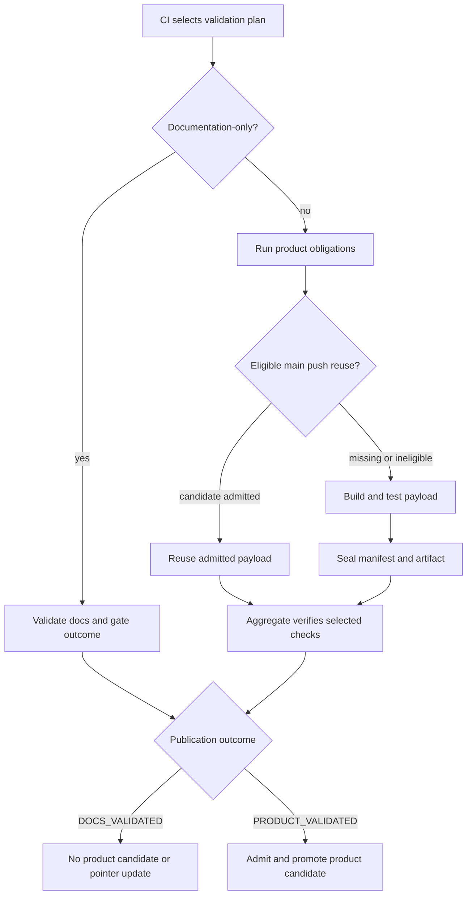

# Release candidates and promotion

## CI policy and candidate lifecycle

CI's `scope` job checks out the event's exact head and derives a validation plan. Documentation-only validation is limited to reviewed authored site inputs; product, installer, generated-schema, script, build-configuration, protected, mixed, and unknown changes keep the applicable broader obligations. The aggregate gate verifies the selected plan and check outcomes rather than treating an arbitrary passing run as authorization.

When product work is required, `source-work` attempts candidate reuse only on a main push, with semantic fixtures disabled. If no reusable candidate is admitted, it builds and validates the payload, then retains the candidate artifact with a manifest identifying repository, source commit and tree, CI run and attempt, event, platform, toolchain, version, and assets (names, byte counts, SHA-256). Candidate identity is therefore tied to tested inputs and producer, not just a version label.

This diagram shows how CI scope, candidate creation or reuse, and validation outcomes constrain publication.

## Documentation and developer publication

Developer promotion distinguishes `DOCS_VALIDATED` from `PRODUCT_VALIDATED`. The documentation outcome completes without creating a candidate, promotion record, product release, or updating the developer pointer; it does not associate a documentation revision with an older binary. Product publication requires the outcome record from the exact successful main push run and attempt. Missing, malformed, contradictory, or mismatched evidence rejects promotion.

On a main push, `build_candidate.py reuse` looks for the candidate associated with the exact successful producer workflow and source, checks source-tree equality, and admits downloaded files against the candidate inventory and digests. Equal trees permit reuse across a squash merge whose commit ID differs, while the promotion record preserves both the candidate build revision/producer and merged revision/main run. `MISSING` means no candidate was available under policy and permits a fresh build; rejection of a candidate is not permission to reinterpret changed bytes as the tested payload. Incomplete observations, wrong producers, source mismatch, payload mismatch, destination contamination, and download errors fail closed.

## Independent component releases

`distribution/release/component_release.py` admits Control and Host artifacts independently. Its schema-backed records bind the component/version and exact source revision to archive name, digest, size, and component-specific contract metadata. Admission requires exactly the expected owned files and checksum companions; checksums, archive size and digest, and archive contents are verified. Host variants carry their IntelliJ release line, and paired Host variants must agree on the hosted contract. Control and Host archives therefore cannot be substituted merely because their version strings match.

`packaging/composed_release.py` composes a fresh pair for an ordinary installation, while `assembleControlRelease` and `assembleHostRelease` assemble their respective independent components. Hosted-contract equality and platform admission constrain compatible mixed-version combinations. This component release boundary is separate from the CI candidate manifest and its source/run provenance.

## Published main catalog

The developer catalog retains at most five already-published immutable releases. Entries include main revision, original build revision, source tree, platform, tag/version, and candidate/promotion digests. Ordering follows proven main ancestry, not job completion time or numeric version; an out-of-order publication cannot displace a newer selection. Guarded publication admits assets before updating the catalog and latest pointer together, and rereads after contention.

## Focused verification

Candidate parsing, producer qualification, source-tree reuse, payload integrity, and failure paths are exercised by `.github/scripts/release/test_build_candidate.py` and `distribution/release/test_ci_candidate.py`. Component inventory, record ownership, checksums, and archive constraints are covered by the component release tests. CI validation policy and exact outcome handling have focused tests under `.github/scripts/ci/`.
